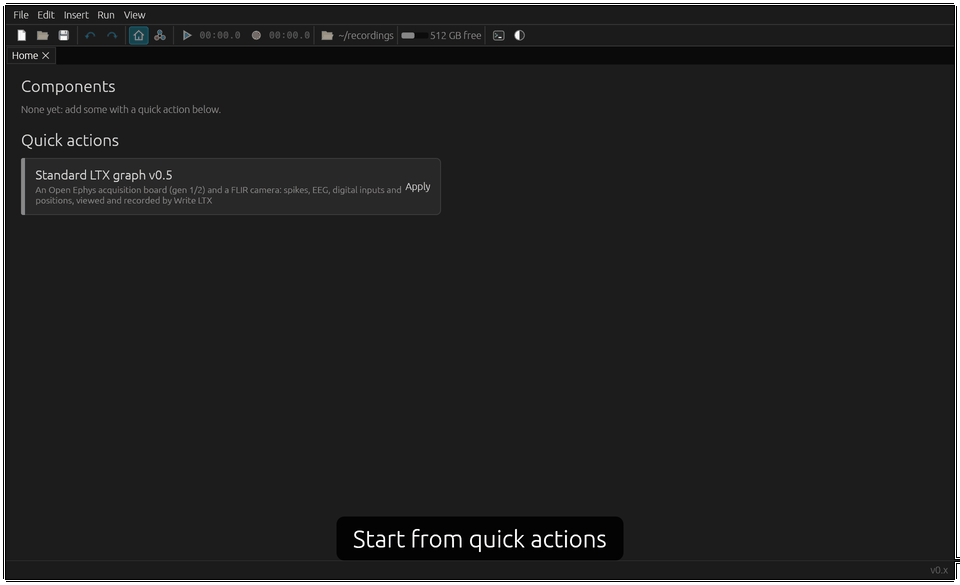

# ephys-rs
Electrophysiology software derived from [Open Ephys](https://github.com/open-ephys), but rewritten in Rust with a custom built execution engine and more flexible user interface.


> [!WARNING]
> ephys-rs is now in alpha testing, for use with [LTX format](https://github.com/ChenNeuroscience/ltx-format) recordings. Development started on 2026-Oct-31 and has moved quickly with the help of AI, under human supervision.

## A quick tour



This is the Chen lab's build, [chen-neuro](examples/chen-neuro), so its quick actions and the way it names recordings are specific to that lab. Yours can differ: see [a build for your lab](#a-build-for-your-lab).

Start from a quick action, or build your own graph of sources, processing, viewers and writers, then press Play. It acquires from Open Ephys and Intan boards and FLIR cameras, and records [LTX format](https://github.com/ChenNeuroscience/ltx-format) or Open Ephys binary.

**[User guide](docs/user/README.md)** describes basic mode and the graph, and each component that comes with ephys-rs: what it does, its settings, and how to connect it.

## Timing and synchronisation

> [!IMPORTANT]
> ephys-rs doesn't put its data streams on a shared clock. Each source produces its own timing, as regular samples at a specified frequency, as timestamps, or both, so times from different sources can't be compared directly.
>
> To line streams up, use TTLs, which can be recorded alongside each stream, and synchronise them in post-processing. We expect to refine this in due course.
>
> **For camera tracking, we highly recommend a real timing LED paired with a voltage TTL.** The camera sees the LED, the acquisition board records the TTL, and matching the two in post-processing synchronises video with electrophysiology.

## Downloads

Each push to `main` is tested and built on Windows and macOS by GitHub Actions, and published as a [release](https://github.com/ChenNeuroscience/ephys-rs/releases). These are the Chen lab's build. On macOS the app isn't notarised, so the first time, right-click it and choose Open.

## A build for your lab

We expect each lab to need its own build, because everyone is doing something a bit special: a different rig, different file names, or a processing step of your own. Our build is in [`examples/chen-neuro`](examples/chen-neuro).

This isn't hard to do, especially with today's AI. Point an agent at this repository, tell it you want a build for your own lab, and describe what's different about your experiments. Your build is a small program that picks the components it needs and adds its own, so most of the work is already done.

## Developing

```bash
cargo run --release                            # the chen-neuro build, starting with an empty graph
cargo test                                     # includes GUI tests, rendered headless against tests/snapshots
UPDATE_SNAPSHOTS=1 cargo test                  # accept changes to how the GUI looks
```

**[Developer docs](docs/README.md)** describes the architecture (the graph, plans, passes and epochs, threads and buffers), and how to write nodes, edges, annotations and quick actions. Turn on the hook that counts the versions up with each commit: `git config core.hooksPath .githooks`.

The code is in three parts:

1. `src/core`: the graph engine, the GUI, and the traits for nodes, annotations and themes. It knows nothing about particular node, edge or annotation types.
2. `src/standard_components`: the components most labs will need, grouped by feature (`ephys`, `spikes`, `tracking`...).
3. `examples/chen-neuro/`: the Chen lab's build, and what this repository releases. It declares which components it's built with, and adds its own: the LTX quick actions, and the subject, date and trial base directory.

The first two are the `ephys-rs` library. To make your own build, add it to a new program with `cargo add --git https://github.com/ChenNeuroscience/ephys-rs ephys-rs`, and use `examples/chen-neuro/` as a starting point: [custom builds](docs/architecture.md#core-standard-components-and-custom-builds) says what you can add.

To run without real hardware, `synthetic_streams/` has stand-ins, which nodes use by default:

- `python3 synthetic_streams/fake_acquisition_board.py` streams an acquisition board's headstage channels (tetrodes picking up spiking units over theta LFP), accelerometers, analogue inputs and digital inputs.
- `python3 synthetic_streams/fake_camera.py` streams video of a mouse with two head LEDs in an arena.
- `python3 synthetic_streams/fake_vr_computer.py` streams positions, TTLs, log lines and settings, as a VR computer does for chen-neuro's VR Computer node.

### Working with an agent

- **Start with the docs.** Ask it to read the [developer docs](docs/README.md) first, then describe what you want in terms of your experiment, not the code.
- **Keep lab-specific work in your build.** Ask before changing `src/core`, as changes there make it harder to take updates.
- **Give it evidence.** Paste the console output or a crash report, or point it at a recording, rather than describing what went wrong.
- **Ask what's been tested.** Have it say what has and hasn't run on real hardware, and whether it could run things on the rig itself or only you could.
- **Say what it may touch.** If it's on the machine with the hardware attached, it can run the app and read the logs itself, which makes debugging much quicker. Tell it when a device is in use, and where it mustn't write, so it doesn't disturb an experiment or your recordings.

### Levels of testing and debugging

Each level catches things the one before can't. An agent can run the first two anywhere, and the last only if it's on the machine with the hardware attached. Otherwise you run that one, and bring back what happened:

1. **Tests:** `cargo test` covers the engine and nodes, and renders the GUI without a window. It compares each render with an image in `tests/snapshots`, which an agent can look at too.
2. **Synthetic data:** the fake board, camera and VR computer above run the whole app with no hardware. `cargo test -- --ignored` runs the end-to-end tests against them.
3. **Dev tools:** Ctrl/⌘ Alt I opens the console, and shows each step's time, the threads and the buffers.
4. **Your rig:** real devices behave differently from the stand-ins, so only this shows that a device works. Connecting logs what it's doing to the console, and [crash reports](docs/development.md#crash-reports) say what was running. Before trusting a new build, make a short recording and check it in [Waveform](https://chenneuroscience.github.io/waveform/).
