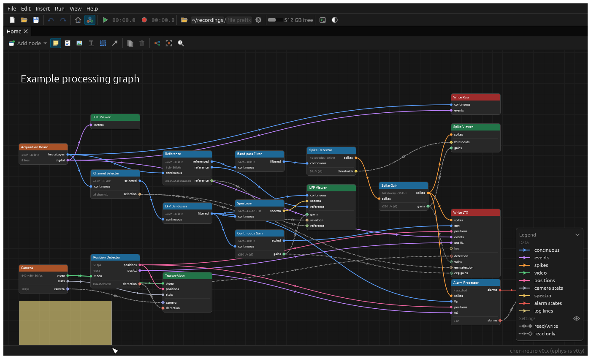

# Annotations

Annotations are things on the canvas that aren't part of the graph: sticky notes, markdown, images, headings, boxes
and arrows. They're saved with the graph and undone with it, but take no part in processing.

An annotation type is a struct implementing [`AnnotationType`](../src/core/annotation.rs), listed in
`annotation_set!` in a program's components (the [chen-neuro's](../examples/chen-neuro/src/components/mod.rs), say); the standard ones are in
[`annotations`](../src/standard_components/annotations/mod.rs). The simplest is the
[sticky note](../src/standard_components/annotations/sticky_note.rs).

- `INFO`: its name, description, and size when added without being drawn out; `MIN_SIZE`.
- `paint_icon`: its tool's icon in the graph's toolbar. Drawing with the tool makes one (`drawn`, told which way it
  was drawn); `DRAWN = false` instead asks for one when the tool's chosen (`choose`: an image from a file, say).
  `pasted`: what's pasted onto the canvas (`Pasted`: an image, or text) is offered to each type, which says how well
  it suits it (`Fit`: `Possible`, `Good` or `Best`) and makes one. The best fit wins; of two as good, the first in
  `annotation_set!`. As it stands, an image makes an image; a single short line, a heading; text in markdown, a
  markdown note; other text, a sticky note. (Settings copied from nodes don't come here: they're recognised, and pasted
  as settings.)
- `settings_ui`: its settings in the annotation pane, while it's selected; `toolbar_ui`: buttons there of its own.
- `hit`, `behind`, `above_graph`: where it can be grabbed, and what it's drawn in front of (a box goes behind other
  annotations and beneath the graph, and is grabbed by its edge, so what's inside it still can be).

The canvas does what's the same for every annotation: selecting it, dragging it (with anything else selected),
double-clicking to edit it, its menu (edit, delete), and which goes in front. The rest is the type's own:

- `canvas_ui(cx)`: draws it, and takes any interaction of its own, with an
  [`AnnotationUi`](../src/core/annotation.rs): where it is (its `pos` and `size`, to change), whether it's selected,
  hovered or being edited, and helpers for what annotations share:
  - `card(fill)`: a background, with a shadow if it's opaque, outlined while selected, with grips in its corner.
  - `resize_corner(aspect)`: a corner to resize it by, keeping a shape if it's given one (an image).
  - `drag_ends(points)` and `mark_ends(points)`: handles to drag (an arrow's ends), and their marks.
  - `content(add)`: its content, laid out at the size it's shown, so text stays sharp at any zoom.
- By default, `canvas_ui` is a card resized by its corner, with `fill` (its background), `paint` (anything over it:
  a border) and `content_ui(ui, editing)` (what it shows, and editing it in place). The sticky note, markdown,
  heading and box use the default; the [image](../src/standard_components/annotations/image.rs) keeps its shape as
  it's resized, and the [arrow](../src/standard_components/annotations/arrow.rs) is dragged by its ends.

Images pasted into a markdown note are kept with it in the file, and shown from where egui loads them.
