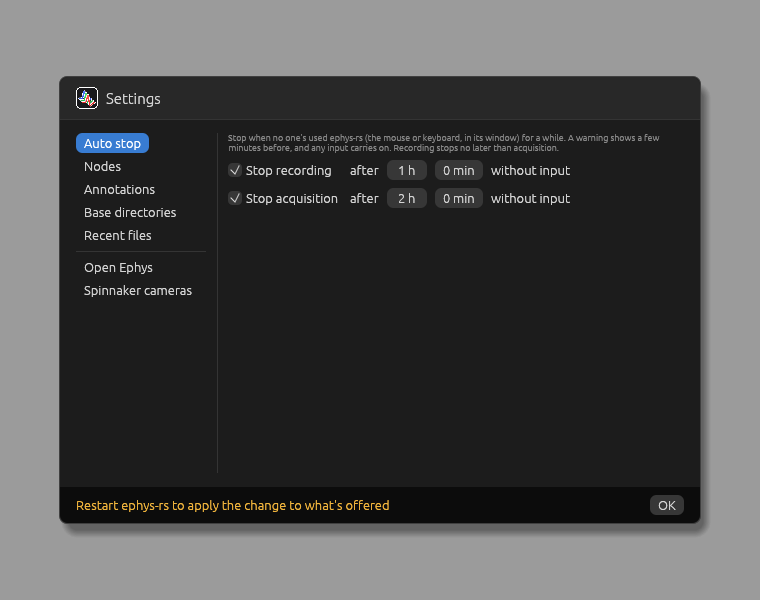

# Architecture

## Core, standard components and custom builds

There are three parts:

- [`src/core`](../src/core/mod.rs): the graph engine, the GUI, and the traits everything else implements. It knows
  nothing about particular node, edge or annotation types.
- [`src/standard_components`](../src/standard_components/mod.rs): the node, edge and annotation types, themes and base
  directory most labs will need, grouped by feature (`ephys`, `spikes`, `tracking`, `recording`...).
- A custom build: a program that declares which components it's made of, including any of its own, and runs them.
  [`examples/chen-neuro/`](../examples/chen-neuro/src/components/mod.rs) is one, and what this repository builds and releases: the standard
  components, with quick actions for the LTX rig and a base directory for subjects, dates and trials.

The first two are the `ephys-rs` library, at the root of the repository; `examples/chen-neuro/` is a program in the same workspace,
so `cargo run` runs it, and its binary is called `ephys-rs` too. A build of your own starts with
`cargo add --git https://github.com/ChenNeuroscience/ephys-rs ephys-rs`, as well as `serde` and `eframe`, which the
macros below use. (`cargo install --git` installs programs, so here that's chen-neuro.)

A build lists its types with `nodes_enum!` (node types, in the order the add-node menu offers them) and
`annotations_enum!`, then implements [`Components`](../src/core/mod.rs) with them, its themes, quick actions and base
directories, and calls `core::gui::run`. Each macro makes an enum with a variant per type, which forwards the traits'
methods to the variant's type, so the core works with one concrete type (`Nodes`, say) without trait objects: the
enum dispatch pattern.

A build can also say what its version is, with `Components::version`. It's shown in the status bar, and `--version`
prints it. The recommendation, for a build for a whole lab, is `core::build_version`: the lab's name, the build's
version, and the core's in brackets, `chen-neuro v0.900 (ephys-rs v0.55)`. Without it, it's just the core's.

Help › About shows the version, with `Components::ABOUT` under it: markdown saying what's special about the build. Help ›
Source Code, and a link in About, go to `Components::SOURCE`, which is this repository unless a fork changes it.

So a build can add nodes, annotations, themes, quick actions and base directories of its own. The kinds of data stream,
setting and trigger are the exception: they're declared once, with `edge_types!` in [`lib.rs`](../src/lib.rs), as the standard
components are written against them, and adding one means adding it there. There's no loading of code at run time, and
no stable interface between versions.

The app's tests are in the library, as they use its internals, but they're of the whole program: `lib.rs` compiles
chen-neuro's components into them. Its own tests run there too.

## The graph and snapshots

The [`Graph`](../src/core/engine/graph.rs) holds node instances (each a `Nodes` value, with its settings, label and
position) and the edges between their ports. Edges are of two dimensions: **data** edges carry data streams from
outputs to inputs, and must form a DAG; **settings** edges let one node edit (or just read) a setting of another, so
can point anywhere. A node's outputs are worked out from what's on its inputs (`Graph::resolve`).

Every edit gives a new [`Snapshot`](../src/core/engine/graph.rs): a frozen, shared version of the graph, with whether
it's recording, and the **plan** for running it. Undo steps back through snapshots; passes run against them.
Snapshots that process the same way (only positions or labels changed) share a plan.

## Plans, passes and epochs

[`run.rs`](../src/core/engine/run.rs) runs the graph, as [`plan.rs`](../src/core/engine/plan.rs) plans it, giving
each node a [`Pass`](../src/core/engine/pass.rs); their module docs are the detail. In short:

- Time is cut into **passes** of 20 ms. A dispatcher thread releases each when its time's up, to a small pool of
  **worker** threads (half the cores, at most four), each running whole passes.
- A pass runs every node in the plan's order, on buffers the worker made for the plan before it ran any pass, so
  nothing's allocated per pass. Each node reads its inputs from the buffers of the nodes before it, and fills its own.
- The **plan** (`Plan::new`) decides which nodes run, in what order, on which buffers:
  - Only nodes whose outputs are known and which aren't disabled can run. Which of those do, and which inputs each
    needs, is up to each, in the tree shake (`Node::evaluate_tree_shake`), given what's running around it: processing
    nodes run only while something needs what they make; sources, viewers and writers run anyway.
  - An output can be made **in place** in an input's buffer (`BufferUsage::in_place`), as long as the other readers of that
    data can run first.
  - A node can **take** an input's buffer (`BufferUsage::takes`), to do as it likes with (swap for one of its own, say).
    Nodes never copy their inputs: the plan does, when it must. The taker gets the buffer itself if it can be the
    last to read it; otherwise the plan copies the data into a buffer of the taker's own as soon as it's made (a
    copy point), before anything edits it in place.
- Passes run at the same time on different workers. A node with **state** carried from pass to pass (a filter's
  history, say) is a sync point: each pass waits its turn for the state, handing it on. Working memory that carries
  nothing over is each worker's own, so there's no waiting.
- When a new snapshot runs the same way (a change of settings), passes carry on with it. Otherwise it starts a new
  **epoch**, with fresh node state: workers make buffers for it as they come free, and passes move over once one's
  ready, so none are lost.

The dev tools show all of this live: the plan each pass runs through, each step's time, sync points, copy points,
buffers made in place or taken, and the threads.

## Threads and buffers

Besides the GUI, the dispatcher and the workers, nodes can run threads of their own (`Node::threads`), shown in the
dev tools with why they're needed:

- **Sources** (the board, the camera, chen-neuro's VR computer) capture on a thread, so samples are taken as they come, whatever the passes are
  doing. Opening one takes a while, so its connection lasts the run rather than an epoch: a new epoch's state joins the
  capture that's running, found in a table of weak references in its module, and the last to let go closes it. A board
  is only opened again for a new configuration, once the old one's closed.
- **Writers** write on a thread, so a stalling disk doesn't hold up the passes, which would otherwise wait for it (the
  files being written in order).

Between such a thread and the passes is a **pool** of buffers shaped like the passes' own
([`pool.rs`](../src/standard_components/pool.rs)), swapped rather than copied. A board's capture thread decodes
straight into a pass's buffers, and each pass swaps whatever's arrived for its own (giving the old one back to
fill). A writer's pass swaps the buffers it takes into a chunk from its pool, and its thread gives the chunk back
once written. Pools hold about a second, so a slow pass or a stalling disk is absorbed. Passes never wait on a pool:
its queues are lock-free (crossbeam's), and a pass finding a source's thread filling a buffer just then leaves it for
the next pass. The dev tools show a pool in the thread at the other end from the passes: its buffers' streams, how many
there are, and where each is (hover for their size), with a dashed arrow for empty buffers going back the other way to the
data; steps that swap rather than copy show a swap icon. A writer's pool is only there while recording. The pass queue's
shown the same way, in the dispatcher.

## Between the GUI and the passes

The passes never wait on the GUI, nor it on them. Each run has an [`Exchange`](../src/core/exchange.rs):

- Each node keeps there whatever its passes and its window share, of any type (`Pass::shared`, `UiContext::shared`).
  The engine and GUI don't treat any of it specially. The usual thing is a [pool](../src/standard_components/pool.rs)
  of buffers, as between nodes' threads and the passes: passes fill buffers (or swap their own in) and queue them;
  the window reads the newest, giving the rest back. A window that needs everything sent, not only the newest (a log's
  lines, the tracker's path), takes every buffer, in order, and keeps what it likes on its own side; until it does,
  what's new waits in the node's state. The dev tools show each such pool on the GUI's thread.
- **Direct triggers** ([`triggers.rs`](../src/core/triggers.rs)) don't wait for a pass: the app delivers them on the GUI's
  thread, running or not, so they belong to it rather than a run. A setting's update from a pass is one.
- Once a run's stopped, the app keeps its exchange, so everything goes on showing what it last had, until the next
  run, or until the graph changes in a way that would start a new epoch (`Plan::same_shape`). Pass triggers need a run.
- The GUI can **trigger** a node (`Node::triggers`), from another node's window through a settings edge, or from the
  node's own. A pass trigger (`AutoDetect`, say) goes to the run's exchange: a pass takes it (`Pass::triggered`), says
  how it's going, and when it's done. A direct one goes to the app, as above. Which is up to the trigger's type.
- Passes can't change the graph, but can **trigger an update** of a setting (`Pass::trigger_settings_update`), which the
  GUI applies as an edit, unless settings are locked.

Settings themselves go the other way through snapshots: a pass sees the snapshot's settings, so a change reaches the
next pass.

## The GUI

[`gui`](../src/core/gui/mod.rs) is an egui app: menus and a toolbar, a dockable layout of panes, and a status bar.
The app is in **basic** or **advanced** mode: in basic mode, the home pane shows the version, with a link to the About
window, the components (viewers, to begin with) and [quick actions](quick-actions.md); in advanced mode, the graph, and each pane has a settings menu. What a
pane shows in each mode is up to it (`UiContext::advanced`). Where panes go when they're opened is the
[layout](quick-actions.md#the-layout)'s to say ([`layout.rs`](../src/core/layout.rs)): windows take steps towards a
default layout, a column on the left and two groups one above another on the right.

What's kept between runs, whatever file's open, is in the app's preferences: the `eframe::Storage` that `App::save`
writes to (the theme, the base directories, the recent files and the settings, under the `*_KEY`s in
[`gui`](../src/core/gui/mod.rs)). File › Open Recent lists the last 10 files opened or saved, as does the basic view while the graph's empty.

File › Settings… ([`preferences`](../src/core/gui/preferences.rs)) has the rest of the preferences, in sections:

- **Auto stop.** Recording stops after an hour without mouse or keyboard input, and acquisition after two, by
  default; each can be off, or longer or shorter (in hours and minutes), but recording's never longer than
  acquisition. The GUI keeps track: in the last minutes before, a warning counts down (any input carries on), and
  after, a notice says what stopped, and when. Running and recording don't depend on the GUI, so a modal doesn't get in
  their way.
- **Nodes, Annotations, Base directories.** Which types are offered: node types in the add-node menu, annotation types
  among the drawing tools, base directory types to choose from. From the next start, and only what's offered: nodes
  and annotations already in a graph, the base directory in use, and quick actions are left as they are.
- **Recent files.** How many are kept (10, by default), and clearing them.

## Recording

Pressing Record asks every node to prepare (`Node::prepare_to_record`: writers open their files, on a thread), in
the [base directory](base-directories.md) chosen in the toolbar, then the snapshots record, and nodes see
`Pass::recording`. The graph's saved with the recording, as `<name>.ephys-rs.json`. While recording, settings are
locked: changes are undone.
Stopping lets writers finish their files in the background ([`background.rs`](../src/core/background.rs)), which they can
ask to hear about (`OnFinished`). Recording stopping isn't the files being finished.

## Crashes

A crash, anywhere, writes a report (the thread, the pass and node it was running, a backtrace, the log) and ends the
program; the next start says where the report is. See [`crash.rs`](../src/core/crash.rs) and
[Development](development.md#crash-reports).

Not every crash can be caught as it happens: a native library can end the program itself, and outside Windows native
crashes aren't caught at all. So each run keeps a session file beside the reports, of the log as it goes, locked while it
runs and emptied when it ends properly. If the next run finds something in it, it makes a report of that, saying what
the program last said. What's logged reaches it from the GUI's frames, so before calling something that might crash,
`crash::note` puts a line there straight away, as Spinnaker's opening and closing do.
