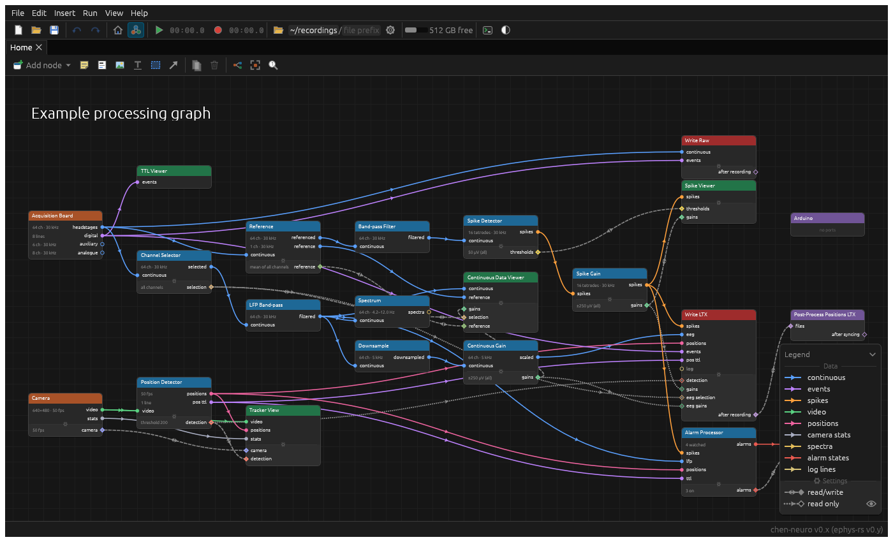
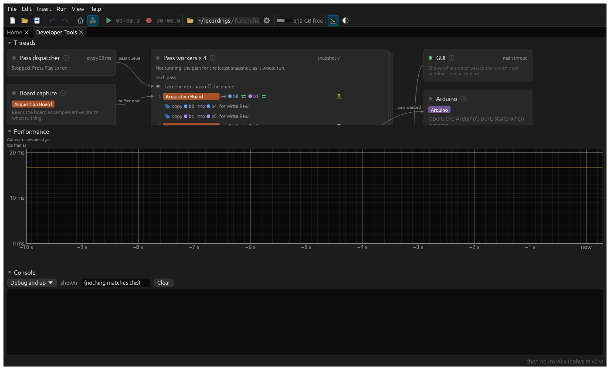
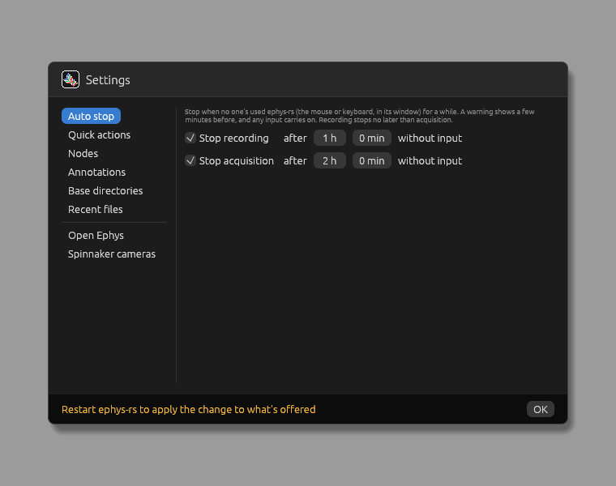
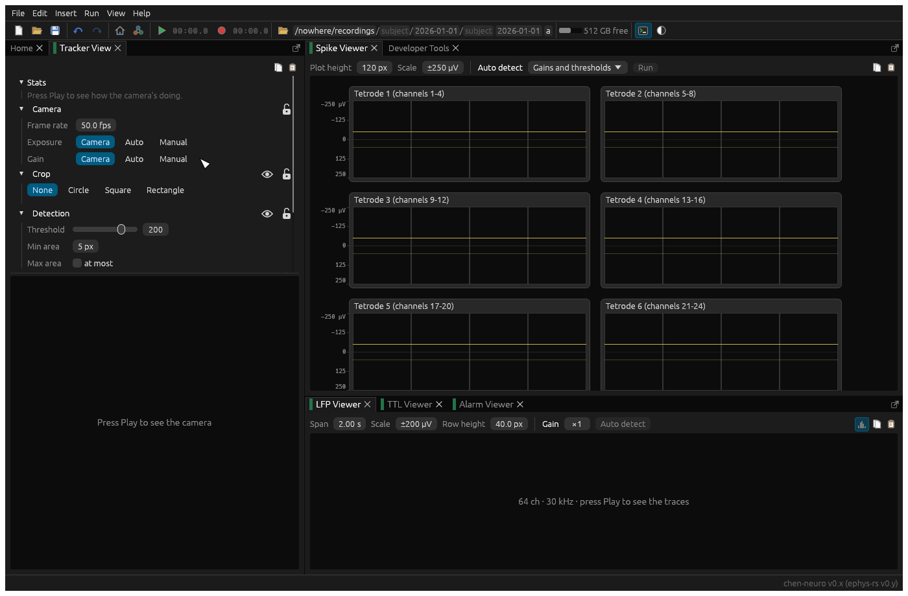

# Architecture

## The framework, standard components and custom builds

There are three parts:

- The framework, the `ephys-rs` crate, in [`src/`](../src/lib.rs): `ephys_rs::engine`, `ephys_rs::gui` and the rest,
  the graph engine, the GUI, and the traits everything else implements. It knows nothing about particular node, edge or
  annotation types, and doesn't depend on the standard components.
- The standard components, the `ephys-rs-standard` crate, in [`standard/`](../standard/src/lib.rs): the node, edge and
  annotation types, themes and base directory most labs will need, grouped by feature (`ephys`, `spikes`, `tracking`,
  `recording`...), and the kinds of data and settings they share (`ephys_rs_standard::Edges`, `DataStream`...).
- A custom build: a program that declares which components it's made of, including any of its own, and runs them.
  [`examples/chen-neuro/`](../examples/chen-neuro/src/components/mod.rs) is one, and what this repository builds and releases: the standard
  components, with quick actions for the LTX rig and a base directory for subjects, dates and trials.

All three are in one workspace, and the two libraries share a version (ephys-rs's: see
[versions](development.md#versions)). `cargo run` runs chen-neuro, whose binary is called `ephys-rs` too. A build of
your own starts with `cargo add --git https://github.com/ChenNeuroscience/ephys-rs ephys-rs ephys-rs-standard`, as well
as `serde` and `eframe`, which the macros below use. (`cargo install --git` installs programs, so here that's chen-neuro.)

A build lists its types with `nodes_enum!` (node types, in the order the add-node menu offers them) and
`annotations_enum!`, then implements [`Components`](../src/lib.rs) with them, its themes, quick actions and base
directories, and calls `gui::run`. Each macro makes an enum with a variant per type, which forwards the traits'
methods to the variant's type, so the framework works with one concrete type (`Nodes`, say) without trait objects: the
enum dispatch pattern. Each also makes a second enum, named in the macro call, of just the types, with the same variants
holding nothing (`NodeType`, say, implementing `NodeTypeEnum`): for a node's type, or the add-node menu's, rather than an
index or a name.

A build can also say what its version is, with `Components::version`. It's shown in the status bar, and `--version`
prints it. The recommendation, for a build for a whole lab, is `build_version`: the lab's name, the build's
version, and the core's in brackets, `chen-neuro v0.900 (ephys-rs v0.55)`. Without it, it's just the core's.

Help › About shows the version, with `Components::ABOUT` under it: markdown saying what's special about the build. Help ›
Source Code, and a link in About, go to `Components::SOURCE`, which is this repository unless a fork changes it.

So a build can add nodes, annotations, themes, quick actions and base directories of its own. The kinds of data stream,
published value and command are the exception: they're declared once, with `edge_types!` in the standard components'
[`lib.rs`](../standard/src/lib.rs), as they're written against them, and adding one means adding it there. There's no loading of code at run time, and
no stable interface between versions.

The app's tests are in the framework, as they use its internals, but they're of the whole program: its `lib.rs`
compiles the standard components and chen-neuro's into them, as modules (`crate::standard`, which the standard
components call themselves, and `crate::components`), and their own tests run there too. A dev-dependency on them
instead would bring in a second copy of the framework, which the tests' types couldn't be mixed with. So the standard
components' own test build is empty (their build script sets `standard_crate`, which the framework's doesn't), and
chen-neuro's binary isn't tested.

## The graph and snapshots

The [`Graph`](../src/engine/graph.rs) holds node instances (each a `Nodes` value, with its settings, label and
position) and the edges between their ports. Edges are of two dimensions: **data** edges carry data streams from
outputs to inputs, and must form a DAG; **settings** edges let one node edit (or just read) a setting of another, so
can point anywhere. A node's outputs are worked out from what's on its inputs (`Graph::resolve`).

The app owns what the passes need to know: the graph (the current item of the undo history), when the run started
(Play) and the recording it's taken on (Record), with when. A [`Snapshot`](../src/engine/graph.rs) is all that baked
(`Snapshot::bake`), with the **plan** for running it: frozen, shared, and baked again whenever any of it changes (an
edit, undone or redone, a run starting or stopping, recording starting or stopping), each a new **version**. Passes
run against them. Undo and redo step between the items of the history (the graph and annotations, as each edit left
them), not snapshots: undoing an edit changes the graph, which is baked like any edit.

Given a snapshot, the run has each node with state prepare for it (`Node::prepare_for_snapshot`), one snapshot at a
time, on a thread of its own; a newer snapshot given meanwhile replaces one waiting its turn, so a burst of changes
prepares only the latest. A node makes its state ahead of time (proto-states: shared, and one per worker), or nothing
new, so its state carries on; slow work (opening a device) is started and waited for once every node's been asked.
At the snapshot's first pass the new state's made from the proto-state (`Node::on_snapshot_change`), and each worker's
replaced by its own, so nothing's allocated on the passes. A node says what someone should decide as it
prepares (`UserDecision`: a source's hardware not as its settings say, say): the snapshot runs meanwhile, and the app
asks ([`user_decisions`](../src/gui/user_decisions.rs)) whether to take what the node suggests, carry on without the
node, or stop. A node that fails to prepare is asked about the same way, and doesn't run.

## Plans and passes

[`run.rs`](../src/engine/run.rs) runs the graph, as [`plan.rs`](../src/engine/plan.rs) plans it, giving
each node a [`PassContext`](../src/engine/pass_context.rs); their module docs are the detail. In short:

- Time is cut into **passes** of 20 ms. A dispatcher thread releases each when its time's up, to a small pool of
  **worker** threads (half the cores, at most four), each running whole passes.
- A pass runs every node in the plan's order, on buffers the worker made for the plan before it ran any pass, so
  nothing's allocated per pass. Each node reads its inputs from the buffers of the nodes before it, and fills its own.
- The **plan** (`Plan::new`) decides which nodes run, in what order, on which buffers:
  - Only nodes whose outputs are known and which aren't disabled can run. Which of those do, and which inputs each
    needs, is up to each, in the tree shake (`Node::evaluate_tree_shake`), given what's running around it: processing
    nodes run only while something needs what they make; sources and viewers run anyway, and writers while recording.
  - An output can be made **in place** in an input's buffer (`BufferUsage::in_place`), as long as the other readers of that
    data can run first.
  - A node can **take** an input's buffer (`BufferUsage::takes`), to do as it likes with (swap for one of its own, say).
    Nodes never copy their inputs: the plan does, when it must. The taker gets the buffer itself if it can be the
    last to read it; otherwise the plan copies the data into a buffer of the taker's own as soon as it's made (a
    copy point), before anything edits it in place.
- Passes run at the same time on different workers. A node with **state** carried from pass to pass (a filter's
  history, say) is a sync point: each pass waits its turn for the state, handing it on. Working memory that carries
  nothing over is each worker's own, so there's no waiting.
- Each snapshot hands each node's state, and what it shares with the GUI, on to the next, as long as it's the same
  node with the same data streams in and out: a change of settings, or adding a viewer elsewhere, leaves a filter's
  history be. A node whose streams change starts afresh. The dispatcher attaches the snapshot to each pass it sends,
  so snapshots only move forward. A snapshot whose plan needs other buffers runs once every worker has made them, as
  they come free, the one before carrying on meanwhile, so no pass is lost; a recording takes effect with its
  snapshot's first pass. The dev tools say which snapshot is running, with what it keeps from the one before beside it.

The dev tools show all of this live: the plan each pass runs through, each step's time, sync points, copy points,
buffers made in place or taken, and the threads.

## Threads and buffers

Besides the GUI, the dispatcher and the workers, nodes can run threads of their own (`Node::threads`), shown in the
dev tools with why they're needed:

- **Sources** (the board, the camera, chen-neuro's VR computer) capture on a thread, so samples are taken as they come, whatever the passes are
  doing. Opening one takes a while, so its connection lasts the run rather than the node's state: fresh state joins the
  capture that's running, found in a table of weak references in its module, and the last to let go closes it. A board
  is only opened again for a new configuration, once the old one's closed.
- **Writers** write on a thread, so a stalling disk doesn't hold up the passes, which would otherwise wait for it (the
  files being written in order).

Between such a thread and the passes is a **pool** of buffers shaped like the passes' own
([`pool.rs`](../standard/src/pool.rs)), swapped rather than copied. A board's capture thread decodes
straight into a pass's buffers, and each pass swaps whatever's arrived for its own (giving the old one back to
fill). A writer's pass swaps the buffers it takes into a chunk from its pool, and its thread gives the chunk back
once written. Pools hold about a second, so a slow pass or a stalling disk is absorbed. Passes never wait on a pool:
its queues are lock-free (crossbeam's), and a pass finding a source's thread filling a buffer just then leaves it for
the next pass. Nor on the thread's status (counts, state, what went wrong), which a pass copies for the node's window
(`try_lock`): if the thread's updating it just then, that pass sends none, or the camera's its last copy, and the next
pass shows it. Status is how things stand, not a run of events, so nothing's lost. The dev tools show a pool in the thread at the other end from the passes: its buffers' streams, how many
there are, and where each is (hover for their size), with a dashed arrow for empty buffers going back the other way to the
data; each buffer swapped rather than copied (an input taken, or an output its thread filled) shows a swap icon. A writer's pool is only there while recording. The pass queue's
shown the same way, in the dispatcher.

## Between the GUI and the passes

The passes never wait on the GUI, nor it on them.

- Each node says what its passes share with the GUI (`Node::Shared`; see [`shared.rs`](../src/engine/shared.rs)),
  made afresh whenever its data streams change, for its data streams then (`PassContext::shared`, `UiContext::shared`). The engine and GUI don't
  treat any of it specially. The usual thing is a [pool](../standard/src/pool.rs)
  of buffers, as between nodes' threads and the passes: passes fill buffers (or swap their own in) and queue them;
  the window reads the newest, giving the rest back. A window that needs everything sent, not only the newest (a log's
  lines, the tracker's path), takes every buffer, in order, and keeps what it likes on its own side; until it does,
  what's new waits in the node's state. The dev tools show each such pool on the GUI's thread.
- **Commands** ([`commands.rs`](../src/commands.rs)) don't wait for a pass: the app delivers them on the GUI's
  thread, running or not, so they belong to it rather than a run. A setting a pass found (an auto detect's) is one.
- Once a run's stopped, the app keeps what its last snapshot shared, so everything goes on showing what it last had,
  until the next run, or until the graph changes so it would need new buffers (`Plan::same_shape`).
- A node can **command** another (`Node::on_command`), through a value edge from its `ValInCmdOut` port: set the value
  the other publishes, start its auto detect, process files. Having a node do something with the data over a while (an
  auto detect) is kept as its **transient state**: the node prepares for it, runs while it's set, and its passes clear
  it with what they found; the app has every node clear it (`Command::ClearTransientState`) on undo and redo, and as
  recording starts or running stops.
- Passes can't change the graph, but can **command their node** (`PassContext::cmd_self`), which the GUI applies as an
  edit (undone while recording, if it changes how the graph processes).
- They can have the app start or stop recording (`PassContext::request_recording`), as the toolbar's Record does: TTL
  Recording Control does, by a TTL line. A pass's snapshot, as much of it as nodes can see (`PassContext::snapshot`, a
  `SnapshotLite`), says when acquisition and recording started, by the monotonic clock (`started`, and
  `Recorded::started`, when the app took the recording on), the latter as opposed to when it was asked for, which names
  and dates it (`Recording::start_requested_date`); and whether it's recording (`PassContext::recording`). A node's own thread, which carries on between passes, can keep a pass's
  snapshot, without locks: the very one, shared (how long it's been acquiring and recording, as of whenever it asks).
  The VR Computer's keeps the newest its passes hand over.

Settings themselves go the other way through snapshots: a pass sees the snapshot's settings, so a change reaches the
next pass.

## The GUI

[`gui`](../src/gui/mod.rs) is an egui app: menus and a toolbar, a dockable layout of panes, and a status bar.
The app is in **basic** or **advanced** mode: in basic mode, the home pane shows the version, with a link to the About
window, the components (viewers, to begin with) and [quick actions](quick-actions.md); in advanced mode, the graph, and each pane has a settings menu. What a
pane shows in each mode is up to it (`UiContext::advanced`). Where panes go when they're opened is the
[layout](quick-actions.md#the-layout)'s to say ([`layout.rs`](../src/layout.rs)): windows take steps towards a
default layout, a column on the left and two groups one above another on the right.

Each time round the app does what isn't drawing first, in `App::logic` (eframe's `App::logic`): taking what's come from
runs and nodes' threads, stopping what's unattended, and keeping the run up to date with the graph. eframe calls it
before each frame, and while the window's hidden (minimised, say) whenever the app's woken (`request_repaint`, as a
run does every 20 ms), without drawing; then, if the window's shown, the app draws (`App::show`). The app
calls every node once a frame (`Node::on_gui_tick`, with its state on the GUI's side, `Node::UiState`): with a `ui` while
drawing its window, if it's shown, and without, for the rest, once the frame's drawn, or from `App::logic` while
nothing's drawn.

What's kept between runs, whatever file's open, is in the app's preferences: the `eframe::Storage` that `App::save`
writes to (the theme, the base directories, the recent files and the settings, under the `*_KEY`s in
[`gui`](../src/gui/mod.rs)). File › Open Recent lists the last 10 files opened or saved, as does the basic view while the graph's empty.

File › Settings… ([`preferences`](../src/gui/preferences.rs)) has the rest of the preferences, in sections:

- **Auto stop.** Recording stops after an hour without mouse or keyboard input, and acquisition after two, by
  default; each can be off, or longer or shorter (in hours and minutes), but recording's never longer than
  acquisition. The GUI keeps track, minimised or not (in `App::logic`): in the last minutes before, a warning counts
  down (any input carries on), and after, a notice says what stopped, and when. Running and recording don't depend on the GUI, so a modal doesn't get in
  their way.
- **Nodes, Annotations, Base directories.** Which types are offered: node types in the add-node menu, annotation types
  among the drawing tools, base directory types to choose from. From the next start, and only what's offered: nodes
  and annotations already in a graph, the base directory in use, and quick actions are left as they are.
- **Recent files.** How many are kept (10, by default), and clearing them.

## Recording

Pressing Record bakes a snapshot recording, planned for it: writers run only while recording, and so does whatever
only feeds them. Its nodes prepare for it, as for any snapshot (`Node::prepare_for_snapshot`: writers open their files, on threads),
in the [base directory](base-directories.md) chosen in the toolbar, while the workers make buffers for the plan; the
run carries on with the snapshot before until both are ready, and the recording takes effect with the first pass that
runs it (`Recording::effective`, also in Write LTX's `.set` file, beside when it was asked for). Nodes see
`PassContext::recording`. The graph's saved with the recording, as `<name>.ephys-rs.json`. While recording, settings are
locked: changes are undone.
Stopping lets writers finish their files in the background ([`background.rs`](../src/background.rs)), which they can
ask to hear about (`OnFinished`). Recording stopping isn't the files being finished.

## Crashes

A crash, anywhere, writes a report (the thread, the pass and node it was running, a backtrace, the log) and ends the
program; the next start says where the report is. See [`crash.rs`](../src/crash.rs) and
[Development](development.md#crash-reports).

Not every crash can be caught as it happens: a native library can end the program itself, and outside Windows native
crashes aren't caught at all. So each run keeps a session file beside the reports, of the log as it goes, locked while it
runs and emptied when it ends properly. If the next run finds something in it, it makes a report of that, saying what
the program last said. What's logged reaches it from the GUI's frames, so before calling something that might crash,
`crash::note` puts a line there straight away, as Spinnaker's opening and closing do.
