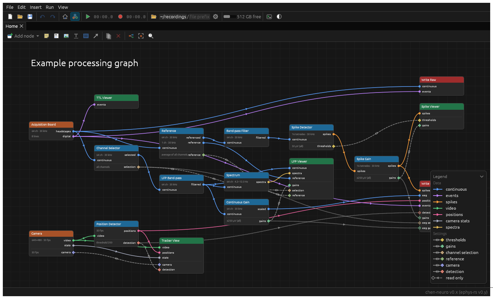
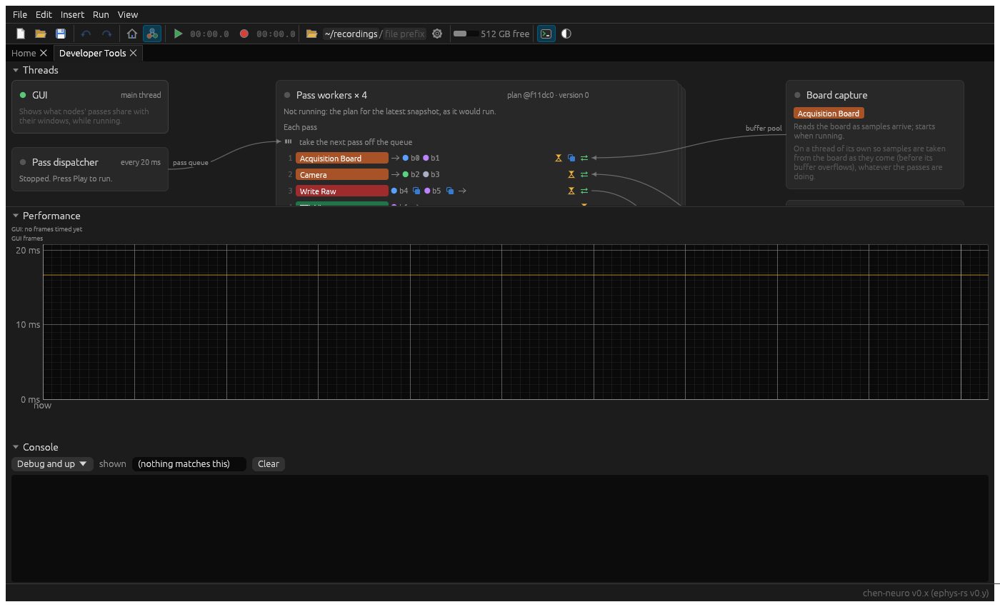
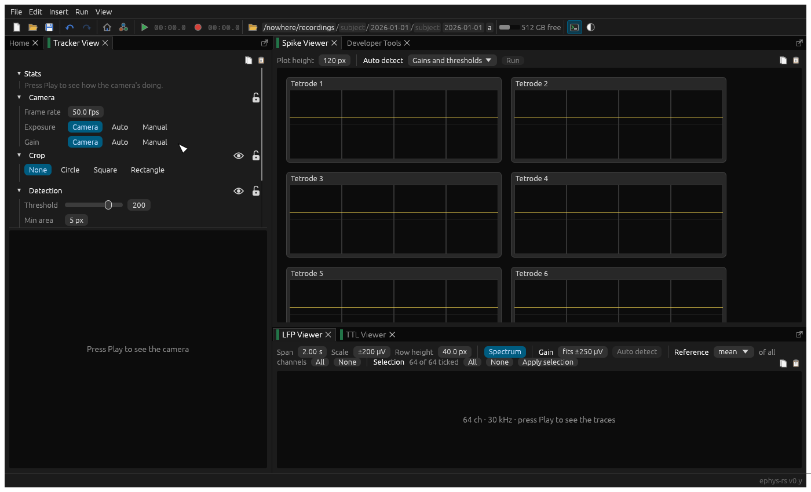

# Architecture

## Core, standard components and custom builds

There are three parts:

- [`src/core`](../src/core/mod.rs): the graph engine, the GUI, and the traits everything else implements. It knows
  nothing about particular node, edge or annotation types.
- [`src/standard_components`](../src/standard_components/mod.rs): the node, edge and annotation types, themes and base
  directory most labs will need, grouped by feature (`ephys`, `spikes`, `tracking`, `recording`...).
- A custom build: a program that declares which components it's made of, including any of its own, and runs them.
  [`example/`](../example/src/components/mod.rs) is one, and what this repository builds and releases: the standard
  components, with quick actions for the LTX rig and a base directory for subjects, dates and trials.

The first two are the `ephys-rs` library, at the root of the repository; `example/` is a program in the same workspace,
so `cargo run` runs it, and its binary is called `ephys-rs` too. A build of your own starts with
`cargo add --git https://github.com/ChenNeuroscience/ephys-rs ephys-rs`, as well as `serde` and `eframe`, which the
macros below use. (`cargo install --git` installs programs, so here that's the example.)

A build lists its types with `node_set!` (node types, in the order the add-node menu offers them) and
`annotation_set!`, then implements [`Components`](../src/core/mod.rs) with them, its themes, quick actions and base
directories, and calls `core::gui::run`. Each macro makes an enum with a variant per type, which forwards the traits'
methods to the variant's type, so the core works with one concrete type (`Nodes`, say) without trait objects.

A build can also say what its version is, with `Components::version`. It's shown in the status bar, and `--version`
prints it. The recommendation, for a build for a whole lab, is `core::build_version`: the lab's name, the build's
version, and the core's in brackets, `chen-neuro v0.900 (ephys-rs v0.55)`. Without it, it's just the core's.

So a build can add nodes, annotations, themes, quick actions and base directories of its own. The kinds of data stream
and setting are the exception: they're declared once, with `edge_types!` in [`lib.rs`](../src/lib.rs), as the standard
components are written against them, and adding one means adding it there. There's no loading of code at run time, and
no stable interface between versions.

The app's tests are in the library, as they use its internals, but they're of the whole program: `lib.rs` compiles the
example's components into them. The example's own tests run there too.

## The graph and snapshots

The [`Graph`](../src/core/engine/graph.rs) holds node instances (each a `Nodes` value, with its settings, label and
position) and the edges between their ports. Edges are of two dimensions: **data** edges carry data streams from
outputs to inputs, and must form a DAG; **settings** edges let one node edit (or just read) a setting of another, so
can point anywhere. A node's outputs are worked out from what's on its inputs (`Graph::resolve`).

Every edit gives a new [`Snapshot`](../src/core/engine/graph.rs): a frozen, shared version of the graph, with whether
it's recording, and the **plan** for running it. Undo steps back through snapshots; passes run against them.
Snapshots that process the same way (only positions or labels changed) share a plan.

## Plans, passes and epochs

[`run.rs`](../src/core/engine/run.rs) runs the graph; its module docs are the detail. In short:

- Time is cut into **passes** of 20 ms. A dispatcher thread releases each when its time's up, to a small pool of
  **worker** threads (half the cores, at most four), each running whole passes.
- A pass runs every node in the plan's order, on buffers the worker made for the plan before it ran any pass, so
  nothing's allocated per pass. Each node reads its inputs from the buffers of the nodes before it, and fills its own.
- The **plan** (`Plan::new`) decides which nodes run, in what order, on which buffers:
  - Only nodes whose outputs are known, which aren't disabled, and whose outputs something needs (`Node::needs`), run.
    Sources, and nodes without outputs (viewers, writers), always do.
  - An output can be made **in place** in an input's buffer (`Node::in_place`), as long as the other readers of that
    data can run first.
  - A node can **take** an input's buffer (`Node::takes`), to do as it likes with (swap for one of its own, say).
    Nodes never copy their inputs: the plan does, when it must. The taker gets the buffer itself if it can be the
    last to read it; otherwise the plan copies the data into a buffer of the taker's own as soon as it's made (a
    copy point), before anything edits it in place.
- Passes run at the same time on different workers. A node with **state** carried from pass to pass (a filter's
  history, say) is a sync point: each pass waits its turn for the state, handing it on. Working memory that carries
  nothing over is each worker's own, so there's no waiting.
- When a new snapshot runs the same way (a change of settings), passes carry on with it. Otherwise it starts a new
  **epoch**, with fresh node state: workers make buffers for it as they come free, and passes move over once one's
  ready, so none are lost.

The dev tools show all of this live: the plan each pass runs through, each step's time, sync points, copy points,
buffers made in place or taken, and the threads.

## Threads and buffers

Besides the GUI, the dispatcher and the workers, nodes can run threads of their own (`Node::threads`), shown in the
dev tools with why they're needed:

- **Sources** (the board, the camera) capture on a thread, so samples are taken as they come, whatever the passes are
  doing.
- **Writers** write on a thread, so a stalling disk doesn't hold up the passes, which would otherwise wait for it (the
  files being written in order).

Between such a thread and the passes is a **pool** of buffers shaped like the passes' own
([`pool.rs`](../src/standard_components/pool.rs)), swapped rather than copied. A board's capture thread decodes
straight into a pass's buffers, and each pass swaps whatever's arrived for its own (giving the old one back to
fill). A writer's pass swaps the buffers it takes into a chunk from its pool, and its thread gives the chunk back
once written. Pools hold about a second, so a slow pass or a stalling disk is absorbed. Passes never wait on a pool:
its queues are lock-free (crossbeam's), and a pass finding a source's thread filling a buffer just then leaves it for
the next pass. The dev tools show each pool on its thread's link: its buffers' streams and sizes, and where each is,
with a dashed arrow back to it from whoever frees buffers into it; steps that swap rather than copy show a swap icon.
The pass queue is shown the same way, on the link between the dispatcher and the workers, which it's between.

## Between the GUI and the passes

The passes never wait on the GUI, nor it on them. Each run has an [`Exchange`](../src/core/exchange.rs):

- Each node keeps there whatever its passes and its window share, of any type (`Pass::shared`, `Context::shared`).
  The engine and GUI don't treat any of it specially. The usual thing is a [pool](../src/standard_components/pool.rs)
  of buffers, as between nodes' threads and the passes: passes fill buffers (or swap their own in) and queue them;
  the window reads the newest, giving the rest back. The dev tools show each such pool on the GUI's thread.
- The GUI can **fire a trigger** on a node (`Node::triggers`): "auto detect", say, from a viewer through a settings
  edge, or from the node's own window. A pass takes it (`Pass::triggered`), says how it's going, and when it's done.
- Passes can't change the graph, but can **propose** a setting's value (`Pass::propose`), which the GUI applies as an
  edit (not while recording, when settings are locked).

Settings themselves go the other way through snapshots: a pass sees the snapshot's settings, so a change reaches the
next pass.

## The GUI

[`gui`](../src/core/gui/mod.rs) is an egui app: menus and a toolbar, a dockable layout of panes, and a status bar.
The app is in **basic** or **advanced** mode: in basic mode, the home pane shows the components (viewers, to begin
with) and [quick actions](quick-actions.md); in advanced mode, the graph, and each pane has a settings menu. What a
pane shows in each mode is up to it (`Context::advanced`). Where panes go when they're opened is the
[layout](quick-actions.md#the-layout)'s to say ([`layout.rs`](../src/core/layout.rs)): windows take steps towards a
default layout, a column on the left and two groups one above another on the right.

## Recording

Pressing Record asks every node to prepare (`Node::prepare_to_record`: writers open their files, on a thread), in
the [base directory](base-directories.md) chosen in the toolbar, then the snapshots record, and nodes see
`Pass::recording`. The graph's saved with the recording, as `<name>.ephys-rs.json`. While recording, settings are
locked: changes are undone.
Stopping lets writers finish their files in the background ([`background.rs`](../src/core/background.rs)).

## Crashes

A crash, anywhere, writes a report (the thread, the pass and node it was running, a backtrace, the log) and ends the
program; the next start says where the report is. See [`crash.rs`](../src/core/crash.rs) and
[Development](development.md#crash-reports).
