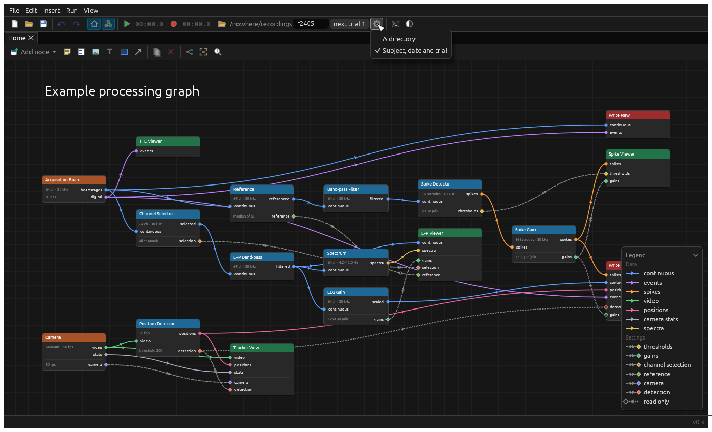

# Base directories

Where recordings go is chosen in a section of the main toolbar, for all the writers at once: the **base directory**.
A program offers kinds of base directory, and one is in use. That's the first, unless you choose another from the
section's settings in advanced mode. The program remembers which one, and what each has (a directory chosen, say),
with its preferences.

## Writing one

A kind of base directory is a [`BaseDirectoryType`](../src/core/base_directory.rs): a name, a description, and
`make`, which makes a `BaseDirectory` from whatever it saved last time (or nothing). The program lists them in
`Components::BASE_DIRECTORIES` ([`main.rs`](../src/main.rs)). A `BaseDirectory`:

- `toolbar_ui`: draws its section of the main toolbar, as wide as it likes. `BaseDirectoryContext::recording` says
  whether it's recording, when what decides where a recording goes shouldn't change. To match the toolbar's
  buttons, use `core::gui::widgets::toolbar_button`.
- `directory`: the base directory for the next recording, or the one going on.
- `recording_started` and `recording_stopped`: to count recordings, say.
- `save`: what it keeps between runs of the program, as JSON.

The standard ones are in [`base_directories.rs`](../src/standard_components/base_directories.rs):

- **A directory**: a button to choose a directory, and the directory.
- **Subject, date and trial**: a directory to keep them in, the subject (an animal's id, say), and the trial, which
  counts up after each recording. Each recording goes in `<directory>/<subject>/<date>/trial_<n>`. Each day, the
  trials start again from the first not yet on disk. Before a recording, the toolbar shows the next trial, which
  you can change; during a recording, it shows the current trial.

## Writers

When recording's asked for, the GUI asks the base directory in use for its directory. Every node then gets it as it
prepares to record (`Node::prepare_to_record`), and from its passes while recording (`Pass::base_directory`). Its
window gets it too (`Context::base_directory`), to show where it'll write. The standard writers have a
[`Location`](../src/standard_components/recording/mod.rs): the base directory, a subdirectory of it, or a directory
of their own.
