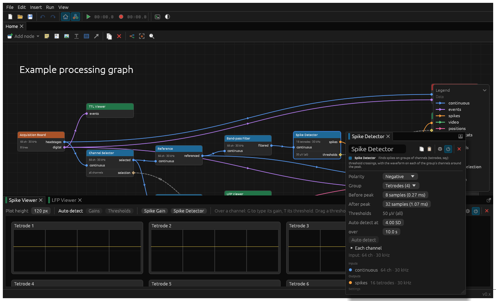

# Nodes

A node type is a struct of its settings implementing [`Node`](../src/core/engine/node.rs), listed in `nodes_enum!` in
a program's components (the [chen-neuro's](../examples/chen-neuro/src/components/mod.rs), say). Its settings are saved in the graph's file (with serde), copied and pasted, and undone;
two nodes of a type differ only in their settings. A simple complete one is the
[Channel Selector](../src/standard_components/ephys/channel_selector.rs): one input, one output, one setting (which
another node can edit).



## Every node is the same kind of thing

**A node's category is only a label.** Sources, processing, visualisation, recording and other look different on the
graph (each has a colour of its own) and are grouped apart in the Add Node menu, and that's all the category does.
Nothing in the engine, the plan or the GUI behaves differently because of it. Every node is a type implementing the one
`Node` trait, and what it does follows from which parts of it the node implements. Any node can implement any of
them: a "visualisation" can have outputs, a "source" can take inputs or triggers, a "processing" node can have a window
of its own, threads, or write files. Pick the category for how the node should look to the people using it, nothing
else.

The parts of the API are there for three different reasons, and it helps to know which is which:

- **The data model: what the node is and does.** These have to be right for the node to work: its ports (`inputs`,
  `outputs`), its settings (`settings`, `set_setting`) and the settings of others it can see (`controls`), `process`
  and the `State` it carries from pass to pass, the triggers it takes, and `prepare_to_record`.
- **Optimisation: how cheaply it runs.** Leaving these at their defaults is always correct, only slower or using more
  memory: `evaluate_buffer_usage`, `evaluate_tree_shake` (one exception: a writer says it only runs with something
  to record, or it would write empty files), working memory instead of state (`CARRIED_OVER = false`), and pools for buffers its threads swap.
- **The experience of using it: how it looks and behaves for people.** These change nothing it computes: its category,
  name and description (`INFO`), `warnings`, its window (`gui_ui`, and `WINDOW_SIZE`), whether
  it's in the basic view (`SHOW_IN_BASIC_DEFAULT`), and how its threads show in the dev tools (`threads`,
  `thread_pool`, `thread_ui`).

## Describing it

- `INFO`: its name, category (source, processing, visualisation, recording or other) and description. The category
  is only a label (see above).
- `inputs()` and `outputs(inputs)`: its data ports. An output says what data stream it produces, given what's on the
  inputs (or `None` while that can't be known), so a graph's streams are worked out before anything runs.
- `warnings(inputs)`: what's wrong (an input not connected, say), shown on the graph and in its window.
- `settings()` and `set_setting`: the settings other nodes can edit through settings edges (see [Edges](edges.md)).
- `controls()`: the other side, settings of other nodes this one can see and edit (or only read, `read_only`), in its
  `UiContext::controls`.

## Running

`process(pass, state)` is called once a pass, on a worker thread, with the pass's buffers (see
[`Pass`](../src/core/engine/pass.rs)): `inputs` to read, `outputs` to fill (already sized: nothing should be allocated
per pass), the settings its `controls` see, whether it's recording, what it shares with the GUI, and its triggers. `self` is the snapshot's
settings: the latest, as of the pass.

- **State.** `type State` is what it keeps between passes, made by `initial_state(inputs)`, and `()` for none. It
  implements `PassState`, saying why it's needed (`WHY`, shown in the dev tools at the sync point it makes). State
  that's only working memory (nothing carried over: `CARRIED_OVER = false`) is each worker's own, and makes no sync
  point. State is fresh each epoch.
- **Buffer usage.** `evaluate_buffer_usage(inputs, outputs)`, asked once per plan, says how the node uses its buffers
  (a `BufferUsage`):
  - **In place.** `in_place[output]` names an input whose buffer the output can be made in, when nothing else needs
    that data after it. Then the input's `None` in the pass, and the output already holds its data.
  - **Taking.** `takes[input]`: the node takes the input's buffer, to do as it likes with (swap it for one of its own,
    say, to hand to its thread or window). Nodes don't copy their inputs; the plan decides when a copy's needed.
    `Pass::take_input` always gives the node a buffer: the input's own, if no one edits that data in place and every
    other reader can run first, otherwise a copy the plan makes as soon as the data's made (a copy point, in the dev
    tools). A node that only reads an input doesn't take it.
- **The tree shake: whether it runs, and what it needs.** It's up to the node: `evaluate_tree_shake(inputs, outputs)`,
  given which of its inputs have something running into them, and which of its outputs have something running that
  needs them, says whether it runs, and which inputs it needs (a `TreeShake`). An input it doesn't need isn't passed,
  and doesn't count as in use for what feeds it (the LFP viewer's spectrum, switched off, stops the
  [Spectrum](../src/standard_components/ephys/spectrum.rs) node). The plan starts with everything that can run running
  and needing everything, asks each node in turn, upstream first, and whenever one's answer changes, asks its
  neighbours again, if what they're told has changed, until nothing does. So the answer must depend only on what it's
  told and its settings; and if more in use never makes a node run or need less, it always settles. A node whose
  answer keeps changing is asked only so many times, then runs, and needs each input, if either of its last two
  answers did, with a warning in the console. By default, a node runs, needing every input, whatever's in use: the
  path without the optimisation, so leaving it is always correct. A node that only makes data for others runs only
  while they're in use, as the processing nodes do. A writer runs only while it's given something to record, as
  what it does matters beyond the graph. Run Command never runs in a pass: it's only ever sent things to do. A node with an output that can't be known doesn't run. Settings change the plan, so what a
  node needs is for what's switched on and off, not what changes pass to pass.

## Its window

Double-clicking a node opens its window, `gui_ui`. By default it's the standard window
([`node_window::standard`](../src/core/gui/node_window.rs)): its name, toolbar, what it is, any problems, and its ports.
A node with settings to set there shows them in the standard window, as most do:

```rust
fn gui_ui(&mut self, ui: &mut egui::Ui, context: &mut UiContext<Edges>) {
    standard(self, ui, context, |node, ui, context| { /* node's settings */ });
}
```

A view of its own (a viewer's, say) draws whatever it likes instead, and says how big its window opens
(`WINDOW_SIZE`). `SHOW_IN_BASIC_DEFAULT` says whether it's listed in the basic view, till that's set for it: by
convention, nodes with a view are. It gets a [`UiContext`](../src/core/engine/ui_context.rs):

- `inputs`: the streams on its inputs; `controls`: the values of the settings its controls see, to edit.
- `shared::<T>()`: what its passes share with it (its `Shared`, which is `T`), or what they did in the last run once
  it's stopped, so what it shows stays (see below). Say nothing's going on when it isn't, by `running`.
- `running` and `locked` (while recording, settings changes are undone, so show them disabled).
- `advanced()`: whether the app's in advanced mode. What a view shows in basic mode is up to it, but basic is meant to
  be simpler; options for it go in its settings menu.
- `node_toolbar` / `node_toolbar_with`: the buttons every node has (copy and paste settings; in advanced mode, its
  settings menu, enabling and deleting it), for a view to put where it likes, with options of its own added to the
  settings menu.
- `node_toolbar_buttons`: the same, with buttons of the pane's own beside them, at the right of the toolbar.
- `controlled_by`: for each setting, the names of the nodes with a control connected to it.
- `trigger`, `can_trigger`, `trigger_progress`, `cancel_trigger`, `open_control_target`: see below.

Help that's more than a tooltip (examples, a cheat sheet) goes behind `widgets::help_link`: dimmed text with a dotted
underline, its help in a popup while the pointer's over it, or, clicked, until something else is. `widgets::with_help`
does the same for something else, such as an icon.

The [Spike Viewer](../src/standard_components/spikes/spike_viewer.rs) and [LFP Viewer](../src/standard_components/ephys/lfp_viewer.rs)
are full examples.

## Sharing with its window

A node says what its passes share with the GUI (its window, and the dev tools: `ThreadContext::shared`) as
`type Shared` (see [`shared.rs`](../src/core/engine/shared.rs)), and `()` for nothing. One's made for each epoch it
runs in, by `shared(inputs)` (by default, `Default`'s), so it's sized for the data streams of the time. The passes reach
it with `Pass::shared`, and the window with `UiContext::shared`, both as the type. Once a run's stopped, the app keeps
its last epoch's, so what's shown stays. It reports its pools of buffers (`Shared::pools`), for the dev tools to show
on the GUI.

The usual thing to share is a [`Pool`](../src/standard_components/pool.rs) of buffers: the same cross-thread pool
sources and writers use with their threads, which can be `Shared` by itself, or one of several in a struct of the
node's. For something to show, only the newest matters:

```rust
// The node's: buffers made by T::default (or by `fn shared`, to size them, say).
type Shared = Pool<TracesDisplay>;

// In process: fill a buffer (an earlier send's, to overwrite), and queue it as of the pass.
pass.shared::<Pool<TracesDisplay>>().send_newest(pass.sequence, |display| display.fill_from(...));

// In gui_ui: the newest queued, held for as long as the view likes.
let pool = context.shared::<Pool<TracesDisplay>>();
let Some(display) = pool.and_then(Pool::newest) else { return };
```

Neither side waits: passes don't skip a send while the window's reading, and if the window's closed, passes reuse the
oldest buffer queued. A node that takes its input can swap it straight in (`Pool::reuse`, then `Pool::send_as_of`), so
nothing's copied: the [Video Viewer](../src/standard_components/tracking/video_viewer.rs) does this with frames.

## On the GUI's side

A node can keep state on the GUI's side, as `type UiState` (and `()` for none): the app keeps one for each node while
the graph has it, whether its window's shown or not, and doesn't save it. Its window gets it with
`UiContext::ui_state::<T>()`, borrowed from the app rather than the context, so the context can still be used.

Work that isn't drawing, but has to happen whether the window's shown or not, goes in `gui_background(context)`: the app
calls it on the GUI's thread every time round, before each frame, and, while the window's hidden (minimised, say),
whenever it's woken (see `App::logic`). It gets the same `UiContext` as the window, so it can take what the passes
share, keep it in its `UiState`, and edit settings as a window would. It returns when it next needs calling, if it does,
and the app's woken then. When everything the passes send matters, not only the newest, they send it all, in order
(`Pool::send_pending`), and `gui_background` takes it (`Pool::receive_all`): the
[Log Viewer](../src/standard_components/logs/log_viewer.rs) keeps lines this way, the Tracker View its path, and the
[Alarm Viewer](../src/standard_components/alarms/viewer.rs) keeps track of alarms going off, pipping as they do, with
its window closed too.

## Triggers

Anything sent to a node is a trigger. Each trigger type implements [`TriggerType`](../src/core/triggers.rs), carrying
whatever it needs to (`AutoDetect` nothing; `RunOnFiles` the files), with a name to show, and how it's delivered
(`DELIVERY`). The program lists them with its edge types, in `edge_types!` (`triggers:`), which makes its `Trigger`
enum, with a variant for each, and `TriggerKind`, naming them, as it does for data streams and settings: they're sent
along settings edges, after all. A node lists the kinds each setting takes, of either delivery, in `triggers(setting)`
(`&[TriggerKind::AutoDetect]`). Sending one is the same either way: a control connected to the setting sends it
(`UiContext::trigger(Some(control), AutoDetect)`), as can the node's own window (`None`), and `UiContext::can_trigger`
says whether it can be sent now. Only taking it differs, as that's on a different thread.

- **`Delivery::Pass`** (`AutoDetect`): for what needs the data going by, so it needs a run. The node's next pass takes
  it (`Pass::triggered(TriggerKind::AutoDetect)`, which gives back the `Trigger`), reports progress
  (`Pass::trigger_progress`, shown with `UiContext::trigger_progress`), and finishes (`Pass::trigger_done`). Meanwhile
  it can be stopped (`UiContext::cancel_trigger`): the passes then see `Pass::trigger_cancelled`, and abandon it. Since
  passes can't change the graph, it triggers an update of what it finds (`Pass::trigger_settings_update(setting,
  value)`), and the GUI applies it as an edit. The [Continuous Gain](../src/standard_components/ephys/continuous_gain.rs),
  [Spike Gain](../src/standard_components/spikes/spike_gain.rs) and
  [Spike Detector](../src/standard_components/spikes/spike_detector.rs) work this way, triggered from the Spike Viewer.
- **`Delivery::Direct`** (`RunOnFiles`): needs no pass, or even a run. It's delivered on the GUI's thread, whatever's
  going on, to `Node::on_trigger`, as the `Trigger` (`if let Trigger::RunOnFiles(files) = trigger`). As well as from a
  window, a node can send one through a control with a `TriggerHandle`, from the `ControlTriggers` it's given in
  `prepare_to_record` (`handle(control, TriggerKind::RunOnFiles)`), which it can keep and use from any thread. (Only a
  direct trigger has a handle, as a handle can outlive the run: there's none for a pass trigger.)

On their way, triggers are carried as `AnyTrigger`s (boxed), so the run's and the app's queues needn't know the
program's enum, as node state is kept; what's sent and what's taken is always the enum.

Every setting also takes a direct update of its value without saying so, the settings update above, which isn't
applied while settings are locked.

## Threads of its own

A node can run threads (started in `initial_state`, stopped when its state's dropped). It lists them in `threads()`,
with which way data goes and why it's a thread, draws what each is up to in `thread_ui`, and reports any pool of
buffers it swaps with the passes in `thread_pool`, all for the dev tools. A source's thread fills buffers shaped like
the node's outputs from a [`Pool`](../src/standard_components/pool.rs), which `process` swaps into the pass; see the
[board's capture](../src/standard_components/ephys/board/capture.rs). A writer's passes swap their data into chunks
from a pool, for its thread to write; see [`recording`](../src/standard_components/recording/mod.rs).

## Recording

`prepare_to_record` is called on a thread of its own before recording starts (a writer opening its files), given when
the recording starts, to name or date what it writes by: the same for every node, and for the settings saved with
it, as preparing can take a while. What it returns comes back to the first pass that records (`Pass::take_prepared`).
Passes see `Pass::recording`. The graph can't change while recording, so everything that records has prepared.

A writer has an "after recording" control. Connected to a setting that takes the `run_command::RunOnFiles` trigger (a direct one),
it sends the paths of the files once they're finished (not when recording stops, which is sooner), and only if
something was recorded. The [Run Command](../src/standard_components/other/run_command.rs) node takes it, and neither
knows what's at the other end: anything can send files to run on.

Run Command has an "after running" control of its own: once what it ran is done, it sends the same files on to what's
connected there (another Run Command, say), if every command succeeded, if any failed, or either way, as its "Then"
setting says (only shown while something's connected), but never if it was stopped. Run by hand, it sends itself the
files, so it's the same either way. A loop of settings edges into settings that take triggers (one Run Command after
another, round to the first) could go on for ever: the graph warns of it on each node in the loop (see
`Graph::trigger_loops`), and Stop ends it.

Settings sit on the right of a node on the graph and controls on the left, unless a port's `on_right` says otherwise: the
"after recording" control's on the right, and Run Command's setting on the left, as what passes between them flows
onward, like data.

## Work outside a run

Not everything a node does belongs to a pass. The nodes in the Other category aren't about data as it's acquired: [Run
Command](../src/standard_components/other/run_command.rs) runs a program in a terminal of its own, with or without a run.
The terminal's a separate process, which can be stopped from the node, and which carries on if the app quits.
A node's UI can see what's connected to its settings (`UiContext::controlled_by`): while a writer's connected, it's all Run
Command runs on, so it says so and doesn't offer files of its own.

## Testing

A node's `process` can be run on its own: make buffers from a stream (`stream.buffer(PASS_DURATION)`), and a pass
with `Pass::new`. Most node files have tests doing just that; for triggers, trigger one on the pass's `triggers` (see the
Spike Gain's tests), and give it what it shares with `pass.shared`. Views are tested headless with `egui_kittest`, against images in `tests/snapshots` (see
[Development](development.md)).
