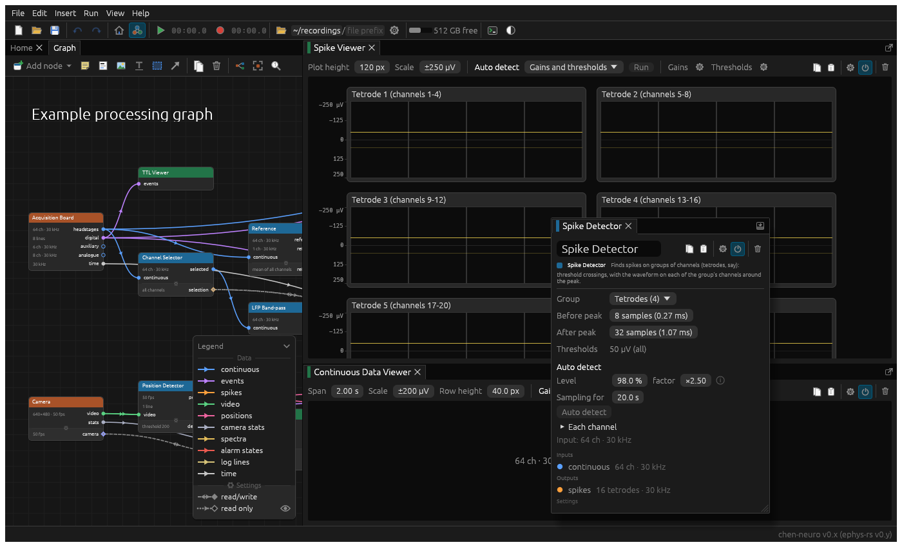

# Nodes

A node type is a struct of its settings implementing [`Node`](../src/engine/node.rs), listed in `nodes_enum!` in
a program's components (the [chen-neuro's](../examples/chen-neuro/src/components/mod.rs), say). Its settings are saved in the graph's file (with serde), copied and pasted, and undone;
two nodes of a type differ only in their settings. A simple complete one is the
[Channel Selector](../standard/src/ephys/channel_selector.rs): one input, one output, one setting (which
another node can edit).



## Every node is the same kind of thing

**A node's category is only a label.** Sources, processing, visualisation, recording and other look different on the
graph (each has a colour of its own) and are grouped apart in the Add Node menu, and that's all the category does.
Nothing in the engine, the plan or the GUI behaves differently because of it. Every node is a type implementing the one
`Node` trait, and what it does follows from which parts of it the node implements. Any node can implement any of
them: a "visualisation" can have outputs, a "source" can take inputs or triggers, a "processing" node can have a window
of its own, threads, or write files. Pick the category for how the node should look to the people using it, nothing
else.

The parts of the API are there for three different reasons, and it helps to know which is which:

- **The data model: what the node is and does.** These have to be right for the node to work: its ports (`inputs`,
  `outputs`), its settings (`settings`, `set_setting`) and the settings of others it can see (`controls`), `process`
  and its state (prepared for each snapshot: `prepare_for_snapshot`), and the triggers it takes.
- **Optimisation: how cheaply it runs.** Leaving these at their defaults is always correct, only slower or using more
  memory: `evaluate_buffer_usage`, `evaluate_tree_shake` (one exception: a writer says it only runs while recording,
  with something to record, or it would write empty files), worker state instead of shared state where nothing's carried over (`WorkerState`), and pools for buffers its threads
  swap.
- **The experience of using it: how it looks and behaves for people.** These change nothing it computes: its category,
  name and description (`INFO`), `warnings`, its window (`on_gui_tick`, and `WINDOW_SIZE`), whether
  it's in the basic view (`SHOW_IN_BASIC_DEFAULT`), and how its threads show in the dev tools (`threads`,
  `thread_pool`, `thread_ui`).

## Describing it

- `INFO`: its name, category (source, processing, visualisation, recording or other) and description. The category
  is only a label (see above).
- `inputs()` and `outputs(inputs)`: its data ports. An output says what data stream it produces, given what's on the
  inputs (or `None` while that can't be known), so a graph's streams are worked out before anything runs.
- `warnings(inputs)`: what's wrong (an input not connected, say), shown on the graph and in its window.
- `settings()` and `set_setting`: the settings other nodes can edit through settings edges (see [Edges](edges.md)).
- `controls()`: the other side, settings of other nodes this one can see and edit (or only read, `read_only`), in its
  `UiContext::controls`.

## Running

`process(pass, state, worker_state)` is called once a pass, on a worker thread, with the pass's buffers (see
[`PassContext`](../src/engine/pass_context.rs)): `inputs` to read, `outputs` to fill (already sized: nothing should be
allocated per pass), the settings its `controls` see, whether it's recording, what it shares with the GUI, and its
triggers. `self` is the snapshot's settings: the latest, as of the pass.

- **State.** A node has two kinds, each `()` for none:
  - `type State` is carried from pass to pass (a filter's history). Passes hand it on in order, so they wait for each
    other there (a sync point); it implements `PassState`, saying why it's needed (`WHY`, shown in the dev tools).
  - `type WorkerState` is each worker's own: scratch space, kept so it isn't remade every pass, with nothing carried
    over, so no waiting. Every node has some (`()` for none); the engine gives each worker `Default`'s unless the node
    makes its own as it prepares. The Reference and Channel Selector have it.
- **Preparing for a snapshot.** This is where state is made. Every node prepares for each snapshot the run's
  given (`prepare_for_snapshot`), one after another on a thread of the run's, before any pass runs against it (the
  snapshot before carries on meanwhile). It's told its input data streams, what its controls see, the snapshot's
  recording if it's recording, what its controls can trigger, how many workers there are, and how it was in the
  snapshot before (`previous`: its settings and data streams then, and whether they're the same now). It answers with
  a `Prepared`:
  - `proto_shared_state` and `proto_worker_state` (one per worker): state made ahead of time, to become its state as
    the snapshot takes over, or `None` for nothing new, so its state carries on. A node new to the run, or whose data
    streams have changed (`context.same_streams()`), must make what it has. Most nodes do just that:
    `if context.same_streams() { return Prepared::nothing().into(); }`, then their state for the new streams.
  - `decisions`: anything someone should decide (see below).

  It answers now (`Prepare::Now`), or, if it's started something slow (opening a device, on a thread of its own, or with
  `Prepare::on_thread`), once that's done (`Prepare::Wait`): the waits come once every node's been asked, so they
  overlap. Once it's prepared, that's it: hardware it couldn't open isn't tried again, and hardware that fails later
  just stops giving it data, which it says.

  At the snapshot's first pass, the new state's made from the proto-state: `on_snapshot_change(state, proto_state)` on
  the worker running it, once the pass before has finished with the old state. By default the proto-state's swapped
  in; a node can take what it likes across from the old state instead (a device it has open, say), quickly. Each
  worker's own state is simply replaced by the one made for it, as nothing in it is carried over. What's left of the
  old is let go of in the background. Trying a node
  out, `fresh_state(&node, &inputs)` (or `fresh_states`) is what it makes.
- **Something to decide.** A node can give a `UserDecision` for each thing someone should decide as it prepares: what
  (`what`, in the node's words), and maybe a `suggestion`, the node changed, offered by the node's own label for it
  (the whole suggestion, with each). A source opening a device checks it against its settings, and gives one for each
  thing that isn't as set, suggesting the node with settings matching the hardware ("Use the hardware's settings"), if
  there are such settings; a device that can't be opened is one, with no suggestion. The core says nothing about
  hardware: the copy's the node's. The snapshot runs meanwhile, the node doing what it can (a board whose headstages
  aren't on the ports set acquires none of them), and the app asks whether to take the suggestion, carry on without the
  node (disabling it), or stop. A node
  that makes nothing new keeps what it was asked about before. A node that fails to prepare (it panics, or doesn't make
  state it needs) is asked about the same way, and doesn't run: its outputs are left empty. See the
  [board](../standard/src/ephys/board/node.rs) and the [camera](../standard/src/tracking/camera/node.rs).
- **Buffer usage.** `evaluate_buffer_usage(inputs, outputs)`, asked once per plan, says how the node uses its buffers
  (a `BufferUsage`):
  - **In place.** `in_place[output]` names an input whose buffer the output can be made in, when nothing else needs
    that data after it. Then the input's `None` in the pass, and the output already holds its data.
  - **Taking.** `takes[input]`: the node takes the input's buffer, to do as it likes with (swap it for one of its own,
    say, to hand to its thread or window). Nodes don't copy their inputs; the plan decides when a copy's needed.
    `PassContext::take_input` always gives the node a buffer: the input's own, if no one edits that data in place and
    every other reader can run first, otherwise a copy the plan makes as soon as the data's made (a copy point, in the
    dev tools). A node that only reads an input doesn't take it.
- **The tree shake: whether it runs, and what it needs.** It's up to the node: `evaluate_tree_shake(inputs, outputs,
  recording)`, given which of its inputs have something running into them, which of its outputs have something running
  that needs them, and whether the snapshot's recording, as well as its settings (`self`), says whether it runs, and which inputs it needs (a `TreeShake`). An input it doesn't need isn't passed,
  and doesn't count as in use for what feeds it (the LFP viewer's spectrum, switched off, stops the
  [Spectrum](../standard/src/ephys/spectrum.rs) node). The plan starts with everything that can run running
  and needing everything, asks each node in turn, upstream first, and whenever one's answer changes, asks its
  neighbours again, if what they're told has changed, until nothing does. So the answer must depend only on what it's
  told and its settings; and if more in use never makes a node run or need less, it always settles. A node whose
  answer keeps changing is asked only so many times, then runs, and needs each input, if either of its last two
  answers did, with a warning in the console. By default, a node runs, needing every input, whatever's in use: the
  path without the optimisation, so leaving it is always correct. A node that only makes data for others runs only
  while they're in use, as the processing nodes do. A writer runs only while recording, and given something to record,
  as what it does matters beyond the graph; so what only feeds writers runs only while recording, except while a transient setting has it do something with
  the data (an auto detect: see below), which it has to run to get done; so a Continuous Gain feeding only a writer can have its
  gains detected before recording. Run Command never runs in a pass: it's only ever sent things to do. A node with an output that can't be known doesn't run. Settings change the plan, so what a
  node needs is for what's switched on and off, not what changes pass to pass.

## Its window

Double-clicking a node opens its window. The app calls `on_gui_tick(ui, context)` for every node once a frame, with a
`ui` to draw the window in while it's shown (and `None` otherwise: see below). By default a node draws the standard
window ([`node_window::standard`](../src/gui/node_window.rs)): its name, toolbar, what it is, any problems, and its
ports. A node with settings to set there shows them in the standard window, as most do:

```rust
fn on_gui_tick(&mut self, ui: Option<&mut egui::Ui>, context: &mut UiContext<Edges>) {
    let Some(ui) = ui else { return };
    standard(self, ui, context, |node, ui, context| { /* node's settings */ });
}
```

A view of its own (a viewer's, say) draws whatever it likes instead, and says how big its window opens
(`WINDOW_SIZE`). `SHOW_IN_BASIC_DEFAULT` says whether it's listed in the basic view, till that's set for it: by
convention, nodes with a view are. Keys its window answers to (G over a Spike Viewer's channel, say) go in
`SHORTCUTS`, which the keyboard shortcuts' help lists. It gets a [`UiContext`](../src/engine/ui_context.rs):

- `inputs`: the streams on its inputs; `controls`: the values of the settings its controls see, to edit.
- `shared::<T>()`: what its passes share with it (its `Shared`, which is `T`), or what they did in the last run once
  it's stopped, so what it shows stays (see below). Say nothing's going on when it isn't, by `running`.
- `running` and `locked` (while recording, settings changes are undone, so show them disabled).
- `advanced()`: whether the app's in advanced mode. What a view shows in basic mode is up to it, but basic is meant to
  be simpler; options for it go in its settings menu.
- `node_toolbar` / `node_toolbar_with`: the buttons every node has (copy and paste settings; in advanced mode, its
  settings menu, enabling and deleting it), for a view to put where it likes, with options of its own added to the
  settings menu.
- `node_toolbar_buttons`: the same, with buttons of the pane's own beside them, at the right of the toolbar.
- `controlled_by`: for each setting, the names of the nodes with a control connected to it.
- `trigger`, `can_trigger`, `open_control_target`: see below.

Help that's more than a tooltip (examples, a cheat sheet) goes behind `widgets::help_link`: dimmed text with a dotted
underline, its help in a popup while the pointer's over it, or, clicked, until something else is. `widgets::with_help`
does the same for something else, such as an icon.

The standard components' [`widgets`](../standard/src/widgets.rs) has what their windows share, for a build's
nodes too: a grid of settings (`settings_grid`, with a row each from `setting`), sections, toggles and the like.

The [Spike Viewer](../standard/src/spikes/spike_viewer.rs) and [LFP Viewer](../standard/src/ephys/lfp_viewer.rs)
are full examples.

## Sharing with its window

A node says what its passes share with the GUI (its window, and the dev tools: `ThreadContext::shared`) as
`type Shared` (see [`shared.rs`](../src/engine/shared.rs)), and `()` for nothing. One's made afresh whenever its
data streams change, by `shared(inputs)` (by default, `Default`'s), so it's sized for the data streams of the time. The passes reach
it with `PassContext::shared`, and the window with `UiContext::shared`, both as the type. Once a run's stopped, the app
keeps its last snapshot's, so what's shown stays. It reports its pools of buffers (`Shared::pools`), for the dev tools to
show on the GUI.

The usual thing to share is a [`Pool`](../standard/src/pool.rs) of buffers: the same cross-thread pool
sources and writers use with their threads, which can be `Shared` by itself, or one of several in a struct of the
node's. For something to show, only the newest matters:

```rust
// The node's: buffers made by T::default (or by `fn shared`, to size them, say).
type Shared = Pool<TracesDisplay>;

// In process: fill a buffer (an earlier send's, to overwrite), and queue it as of the pass.
pass.shared::<Pool<TracesDisplay>>().send_newest(pass.sequence, |display| display.fill_from(...));

// In on_gui_tick, drawing: the newest queued, held for as long as the view likes.
let pool = context.shared::<Pool<TracesDisplay>>();
let Some(display) = pool.and_then(Pool::newest) else { return };
```

Neither side waits: passes don't skip a send while the window's reading, and if the window's closed, passes reuse the
oldest buffer queued. A node that takes its input can swap it straight in (`Pool::reuse`, then `Pool::send_as_of`), so
nothing's copied: the [Video Viewer](../standard/src/tracking/video_viewer.rs) does this with frames.

## On the GUI's side

A node can keep state on the GUI's side, as `type UiState` (and `()` for none): the app keeps one for each node while
the graph has it, whether its window's shown or not, and doesn't save it. Its window gets it with
`UiContext::ui_state::<T>()`, borrowed from the app rather than the context, so the context can still be used. A
trigger gets the same context (`on_trigger`), so it too. It's the place for anything that isn't a setting, such as a job the node has
started (as [Run Command](../standard/src/other/run_command/mod.rs) does): the node itself is cloned for undo's
history and when it's duplicated, and compared every frame, so it should hold only its settings.

Work that isn't drawing, but has to happen whether the window's shown or not, goes in `on_gui_tick` too, whether or not
there's a `ui`. The app calls it for every node once a frame: while drawing a shown window, and for every other node
once the frame's drawn; and, while the app's window is hidden (minimised, say), whenever the app's woken (see
`App::logic`). The node gets the same `UiContext` either way, so it can take what the passes share, keep it in its
`UiState`, and edit settings as a window would. While running, the app tries to draw 50 frames a second; while stopped,
only when something changes (input, say). When everything the passes send matters, not only the newest, they send it all, in order (`Pool::send_pending`),
and the node takes it (`Pool::receive_all`; the standard nodes do it in a method of their own, `take_updates`): the
[Log Viewer](../standard/src/logs/log_viewer.rs) keeps lines this way, the Tracker View its path, and the
[Alarm Viewer](../standard/src/alarms/viewer.rs) keeps track of alarms going off, pipping as they do, with
its window closed too.

## Triggers

Anything sent to a node is a trigger: a one-off event, carrying whatever it needs to (`RunOnFiles` its files). Each
trigger type implements [`TriggerType`](../src/triggers.rs), with a name to show. The program lists them with its edge
types, in `edge_types!` (`triggers:`), which makes its `Trigger` enum, with a variant for each, and `TriggerKind`,
naming them, as it does for data streams and settings: they're sent along settings edges, after all. A node lists the
kinds each setting takes in `triggers(setting)` (`&[TriggerKind::RunOnFiles]`). A control connected to the setting
sends one (`UiContext::trigger(Some(control), trigger)`), as can the node's own window (`None`), and
`UiContext::can_trigger` says whether it can be. It needs no pass, or even a run: the app delivers it on the GUI's
thread, whatever's going on, to `Node::on_trigger`, as the `Trigger` (`let Trigger::RunOnFiles(files) = trigger`),
with the same `UiContext` as its window's. As well as from a window, a node can send one through a control with a
`TriggerHandle`, from the `ControlTriggers` it's given as it prepares (`PrepareContext::triggers`,
`handle(control, TriggerKind::RunOnFiles)`), which it can keep and use from any thread. On their way to the app,
triggers are carried as `AnyTrigger`s (boxed), so its queues needn't know the program's enum; what's sent and what's
taken is always the enum.

## Transient settings

Having a node do something over a while, with the data going by, isn't a trigger: it's a **transient setting**, as
the gains and thresholds have for auto detect (`detect.started`: when it was started). It's a
setting like any other: a window, or a viewer through a control, sets it, a change is a new snapshot, it's undoable,
and it's locked while recording. The node prepares for it (an auto detect makes room to sample into, comparing with
the setting in `context.previous`, and lets go of it once it's clear), and runs while it's set (in its tree shake).
Once the node's passes are done, they set what they found, with the transient setting cleared, in one settings update
(`PassContext::trigger_settings_update(setting, value)`), which the GUI applies as an edit; until that takes over, the
node's state says it's done. Stopping it is clearing it. Anything that can see the setting can tell how far along it
is: an auto detect's setting also says how long it samples for (`detect.seconds`), so a window, or a viewer through a
control, estimates it from when it was started (`auto_detect::estimated_progress`). Being transient, it isn't kept:
transient settings aren't saved (`#[serde(skip)]`), and the app clears them (`EdgeType::clear_transient`) when it
restores a graph from its history (undo or redo), duplicates a node, starts recording, or stops running. The
[Continuous Gain](../standard/src/ephys/continuous_gain.rs), [Spike Gain](../standard/src/spikes/spike_gain.rs) and
[Spike Detector](../standard/src/spikes/spike_detector.rs) work this way, started from their windows or a viewer's.

Every setting also takes a direct update of its value without saying so, the settings update above, which isn't
applied while settings are locked.

## Threads of its own

A node can run threads (started as it prepares its state, stopped when its state's dropped). It lists them in `threads()`,
with which way data goes and why it's a thread, draws what each is up to in `thread_ui`, and reports any pool of
buffers it swaps with the passes in `thread_pool`, all for the dev tools. A source's thread fills buffers shaped like
the node's outputs from a [`Pool`](../standard/src/pool.rs), which `process` swaps into the pass; see the
[board's capture](../standard/src/ephys/board/capture.rs). A writer's passes swap their data into chunks
from a pool, for its thread to write; see [`recording`](../standard/src/recording/mod.rs).

New state (when a node's data streams change) is made before the old is dropped. So a thread holding something
that opening again would disturb can carry on from one state to the next: taken across in `on_snapshot_change`, or
held as an `Arc`, found by what it's open to in a list of `Weak`s, and closed once the last state using it is done. The VR Computer keeps its connection like
this, and the [Arduino](../standard/src/other/arduino.rs) its serial port, as opening it resets the Arduino.

## Recording

A recording's snapshot is planned for recording, so with its writers, and its nodes prepare for it as for any
snapshot (`prepare_for_snapshot`): given the recording (`PrepareContext::recording`), with when it was asked for, to name or date
what they write by (the same for every node, and for the settings saved with it, as preparing can take a while). A
writer opens its files then, and carries on with them through the recording's snapshots, but not into another
recording (`recording_changed`). Passes see whether it's recording (`PassContext::recording()`), and when acquiring and
recording started, by the monotonic clock, from their snapshot (`PassContext::snapshot`, a `SnapshotLite`). A node's
thread can find how long, as of whenever it asks, from a pass's snapshot: shared, to keep (the newest it's been given,
say, as the VR Computer's thread does). The run carries on with the snapshot before until every node's prepared and the workers have buffers for the
recording's plan, and the graph can't change while recording, so everything that records has prepared. The recording
takes effect with its first pass, and its durations count from then (`Recording::effective`).
A pass can start or stop recording itself (`PassContext::trigger_recording`), as the toolbar's Record does: see
[TTL Recording Control](../standard/src/other/ttl_recording_control.rs).

A writer has an "after recording" control. Connected to a setting that takes the `run_command::RunOnFiles` trigger,
it sends the paths of the files once they're finished (not when recording stops, which is sooner), and only if
something was recorded. The [Run Command](../standard/src/other/run_command/mod.rs) node takes it, as does
[Post-Process Positions LTX](../standard/src/other/sync_positions/mod.rs), and neither end knows what's at the other: anything can
send files to run on. A control says what it sends (`Node::sends`), and connects to any setting that takes it, whatever
the setting's kind, as well as to its own kind: what's sent is all that passes between them.

Run Command has an "after running" control of its own: once what it ran is done, it sends the same files on to what's
connected there (another Run Command, say), if every command succeeded, if any failed, or either way, as its "Then"
setting says (only shown while something's connected), but never if it was stopped. Run by hand, it sends itself the
files, so it's the same either way. A loop of settings edges into settings that take triggers (one Run Command after
another, round to the first) could go on for ever: the graph warns of it on each node in the loop (see
`Graph::trigger_loops`), and Stop ends it.

Settings sit on the right of a node on the graph and controls on the left, unless a port's `on_right` says otherwise: the
"after recording" control's on the right, and Run Command's setting on the left, as what passes between them flows
onward, like data.

## Global settings

Settings for the whole program on this machine, rather than a graph (where a vendor's library is, say), are global
settings: a type implementing [`GlobalSettings`](../src/global_settings.rs), with a `NAME` and a `ui`, which is a
tab of its own in Settings…, kept between sessions. A node names those it reads, as `type GlobalSettings` (`()` for
none, a type, or a pair or triple), and reads them as they are now, from any thread, with `Self::global_settings()`. A
build has a tab for each type its nodes name, so a component's global settings come with it, without the build listing
them. The [Acquisition Board](../standard/src/ephys/board/open_ephys.rs) reads which folder of the Open
Ephys GUI's its files come from; the [Camera](../standard/src/tracking/camera/spinnaker.rs) where FLIR's SDK
is, with [`SearchFolders`](../src/search_folders.rs): folders to look in first, with a tab's list of them, what's
found and where to get it.

## Work outside a run

Not everything a node does belongs to a pass. The nodes in the Other category aren't about data as it's acquired: [Run
Command](../standard/src/other/run_command/mod.rs) runs a program in a terminal of its own, with or without a run.
The terminal's a separate process, which can be stopped from the node, and which carries on if the app quits.
A node's UI can see what's connected to its settings (`UiContext::controlled_by`): while a writer's connected, it's all Run
Command runs on, so it says so and doesn't offer files of its own.

## Testing

A node's `process` can be run on its own: make buffers from a stream (`stream.buffer(PASS_DURATION)`), and a pass
with `PassContext::new`. Most node files have tests doing just that; for triggers, trigger one on the pass's `triggers`
(see the Spike Gain's tests), and give it what it shares with `pass.shared`. Views are tested headless with
`egui_kittest`, against images in `tests/snapshots` (see [Development](development.md)).
