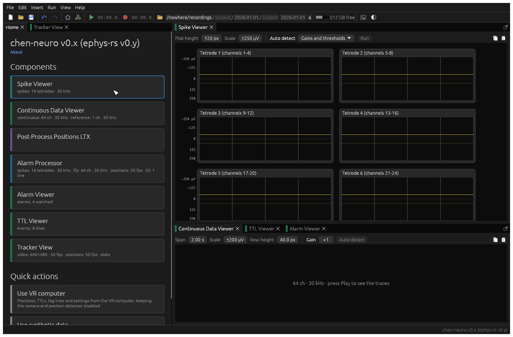

# Quick actions

Quick actions are ready-made changes to the graph, offered in basic mode to people who'd rather not build it node by
node: chen-neuro's "Standard LTX graph", "Use VR computer", "Use synthetic data".



A [`QuickAction`](../src/quick_action.rs) is data, not code, so people can make, change and share their own. Every
quick action is a file in a folder beside the app's settings (`quick_actions/` in eframe's storage directory), listed
in Settings › Quick actions with its description and when it was last changed. A build has none of its own: the
release's zip has chen-neuro's (from [`quick_actions/`](../examples/chen-neuro/quick_actions), copied in by
`scripts/package.py`) in its "Quick actions" folder, for people to import (Settings › Quick actions › **Import…**,
which copies the files chosen into the folder). Tests read them straight from the repository
([`quick_actions.rs`](../examples/chen-neuro/src/components/quick_actions.rs)).

With no quick actions, the home pane links to managing them (Settings › Quick actions) and to building a graph from
scratch in advanced mode; in advanced mode, it links to managing them always.

## What a quick action is

A quick action is a small graph whose nodes are each a **role**, with a rule (`Rule`) saying how it's found in the
graph it's done on, and what's done in each case. The file mirrors the editor: each choice is saved under the
question it answers, and only what isn't the default is written. "Do nothing" (`"do_nothing"`) is the default
everywhere but two: a role not found is created, and a connection whose input is free is connected.

- **`use`**: `false` for a role that plays no part (the editor's unticked box): never matched, and its edges left
  alone, so in a quick action made from a whole graph the parts that don't matter to it can stay, to show what
  surrounds the rest.
- **`match`**: by the node's type, and `{"label": regex}` (such as `(?i)low|lfp`; without one, `.*`, any label; an
  empty one matches nothing). Each role is one node, and each node one role's at most: a role with only one candidate
  is paired with it first (and that node struck off the rest's candidates); when none has just one, the left-most
  role takes its left-most candidate (of two equally far left, the higher); and so on (`QuickAction::find`).
- **`if_found`**: `enable_or_disable` (`"enable"`, `"disable"`), and `settings` (`{"apply": [names]}`, those settings
  set as the quick action has them).
- **`if_not_found`**: `"create"` (the default: the node as the quick action has it, with all its settings,
  enabled), `"do_nothing"` (the quick action is still offered, leaving out the role's edges and window) or
  `"dont_offer"` (the quick action isn't offered).
- **`if_window_open`**: `"close"`. **`if_window_closed`**: `{"open": placement}`, where a window that's been open
  before reopens where it was, and the placement says where it goes the first time: `"default"` (where the app puts
  a new window: see `Layout::place`); `{"by_group_shape": {"shape": "largest", "at": "front"}}` (as a tab in the largest group, or
`"widest"` or `"tallest"`, at the front or `"back"`); or
  `{"anchored": {"to": role, "at": "back"}}` (or `"front"`: as a tab in the group of that role's window, or, if that
  isn't open, where the app puts a new window).

Each edge is between roles, by port id, with what's done in each case (`EdgeRule`): `if_connected` (the nodes found
connected that way already: `"enable"`, `"disable"`); `if_free` (the end that takes just one edge, a data stream's
input or the reading end of a value, free: `"connect"`, the default, or `"do_nothing"`); and `if_occupied` (that end
connected to something else: `"swap"`, to this edge). A quick action never disconnects an edge, and an edge it
connects is enabled. Nodes are never removed: a quick action disables them, which keeps their settings for when
they're wanted again.

`panes.arrangement` arranges the panes (see [the layout](#the-layout)), each window by role. `base_directory`
applies a [base directory](base-directories.md) `mode` (by its type's name; not while recording), with what that mode
has (its directory, say), which the quick action leaves alone; the editor's "Apply mode" takes the mode the app has when
it's chosen.

A quick action is offered while its required roles are found and doing it would change the graph (see
`QuickAction::run`). So one that's done isn't offered until something changes, and closing a window it opened doesn't
bring it back. One that can't change the graph (that only opens and closes windows) is offered while it would change
which windows are open. Doing one is undone in one step.

A role created goes where it is in the quick action relative to a node it's connected to that's in the graph, or,
with none, below the graph; then down, clear of what's there.

chen-neuro's quick actions show each of these: the standard LTX graph creates whatever's missing, telling the spikes'
and the LFP's band-pass filters (Band-pass High and Band-pass Low) apart by their labels; "Use VR computer" and "Use
camera" disable one source, enable the other, swap the edges into the tracker view, Write LTX and the Alarm
Processor, and disable (or enable again) the VR computer's other edges; "Use synthetic data" and "Use real devices"
set `source` on the board and the camera.

## The file

A quick action's file (`name.quick-action.json`) is shaped as a project, with each node's rule beside it (`"quick"`)
and each edge's rule on it, so the app's [config patches](development.md#config-patches) bring an old one up to date
as they would a project:

```json
{
  "ephys-rs quick action": { "core": "0.315.0", "std": "0.315.0", "chen-neuro": "0.1164.0" },
  "name": "Use VR computer",
  "description": "Positions, TTLs, log lines and settings from the VR computer, ...",
  "graph": {
    "next_id": 23,
    "nodes": {
      "12": {
        "label": "Position Detector", "pos": [0, 120],
        "node": { "type": "PositionDetector", "settings": { "...": "..." } },
        "quick": { "if_found": { "enable_or_disable": "disable" }, "if_not_found": "dont_offer" }
      },
      "22": {
        "label": "Log Viewer", "pos": [480, 600],
        "node": { "type": "LogViewer", "settings": { "...": "..." } },
        "quick": {
          "if_found": { "enable_or_disable": "enable" },
          "if_window_closed": { "open": { "anchored": { "to": 10, "at": "back" } } }
        }
      }
    },
    "edges": [
      {
        "from": { "node": 21, "role": "DataStreamOut", "port": "positions" },
        "to": { "node": 13, "role": "DataStreamIn", "port": "positions" },
        "if_connected": "enable", "if_occupied": "swap"
      }
    ]
  }
}
```

A quick action with a node type the build doesn't have can't be read, and Settings says so.

## Making and changing them

In Settings › Quick actions, **New from the graph** (or from the nodes selected) makes one from the graph: each node a
role, created if not found, with nothing done to what's found; the edges between them, connected if free; their open
windows, opened if not. Each
quick action has buttons to edit it, copy it to the clipboard, and delete its file; the folder icon opens the folder.

The editor shows the quick action's nodes and edges as a graph, on a canvas like the app's, most of the window's
size:


- Under each node, what the quick action does with it, in the inspector's words ("If found: disable", "Else:
  create the node", or without an "If found", "If not found: create the node"; "Window: open it if not"), coloured for what happens if it isn't found. Edges that may
  replace another are drawn in the warning colour, and those that do nothing faded.
- The nodes and edges are those the quick action was made with: none can be added or removed in the editor (there's
  no undo there, nor settings to edit), so to change which are in it, make a new one from the graph, or untick the
  parts that don't matter.
- Beside the canvas, the inspector changes what's selected, under a bar naming it (for a node, in its colour, as its
  window's tab is), in sections drawn as a tree; each pair that's one choice (if found, else if not; if the window's
  open, else if not) is drawn as branches of one line. For a node: whether it's used (the box at the right of its
  bar; unticked, it's ignored, and drawn faded); how it's matched (its type, and a label pattern, `.*` by default,
  with a cheat sheet); if found, whether to enable or disable it, and whether to apply settings, and which; else,
  whether to do nothing, create it, or not offer the quick action; and its window, if open (do nothing, or close
  it), else (do nothing, or open it, and where, the first time). "Do nothing" is the first option of every choice
  that has one. For several nodes: a box of them with one checkbox, ticked, empty or
  mixed, to use or ignore them all. For a connection: in a box with a checkbox to use it (unticked,
  it's ignored), its two nodes, each with its port on its right edge, joined by the wire as the canvas draws it; and
  what's done in each case, as branches (if connected already, enable or disable; else, if the input's free, connect the source;
  else, if it's occupied, swap to the source; either way, the source's other connections are left as
  they are). With nothing selected, the quick action's name, description, arrangement and base
  directory. An ⓘ explains the few things that aren't plain: which node is used when several match, the
  label pattern's syntax, connecting "if free", and where a window opens the first time.
- Ignored nodes and edges are drawn faded, with no note.
- **Take the settings of** sets a node's settings from the node it's found as, so one way to change a quick action is
  to do it, change the graph by hand, and take the settings back.

The editor's canvas is the app's (`gui::canvas::Canvas`), drawing the quick action's own graph (`QuickAction::graph`,
put back with `set_graph`). What's different is given by `canvas::Extras`: the badges, the edges' colours, and the
editor's own menus, without annotations, windows or pasting. The app's canvas uses `()`, which adds nothing.

Quick actions are shared as their files: **Import…** in Settings copies files chosen into the folder, and the folder
icon opens it. A quick action's text pasted anywhere settings can be pasted opens it in the editor, to save.

## The layout

The [`Layout`](../src/layout.rs) of panes (home, the dev tools, the annotation pane and node windows: each a tab
in a group, the groups side by side or one above another) has the helpers the app itself uses to place panes, which
quick actions use on a copy of it:

- `open(id, from)` and `close(id)`: a node's window, opened where it was last, or (the first time) placed by `place`.
- `place(pane, from)`: a step towards the **default layout** (`Arrangement::default_layout`: a column a third of the
  width on the left, the full height; on the right, one group above another, two thirds and a third of the height).
  With one group showing, a new column on its right; with two, the second split, the new one below; after that, a tab
  in the largest group other than the one it was opened from (`from`, if it was opened from a pane).
- `largest_group(except)`, `beside(group)` (the group on its right, or failing that its left), `group_of(pane)`,
  `add_tab(group, pane)`, `split(target, pane, side, share)`: for placing panes otherwise. Sizes are worked out from
  the layout itself (`rects`), so panes placed one after another are placed as they'll be.
- `arrange(arrangement)`: replaces the layout with an `Arrangement` of rows, columns and tabs, the panes it doesn't
  place gathered where it says (`Tab::Others`). The standard LTX graph arranges its viewers in the default layout.
  `arrangement()` gives the layout as it is, as an `Arrangement`, for a quick action to keep.

The app places panes it opens itself the same way: a node's window with `place` (from the pane it was opened from:
the graph, the basic view, or another window); the dev tools as a tab in the largest group; the annotation pane in
the group beside home, or failing that a new column on its right.
