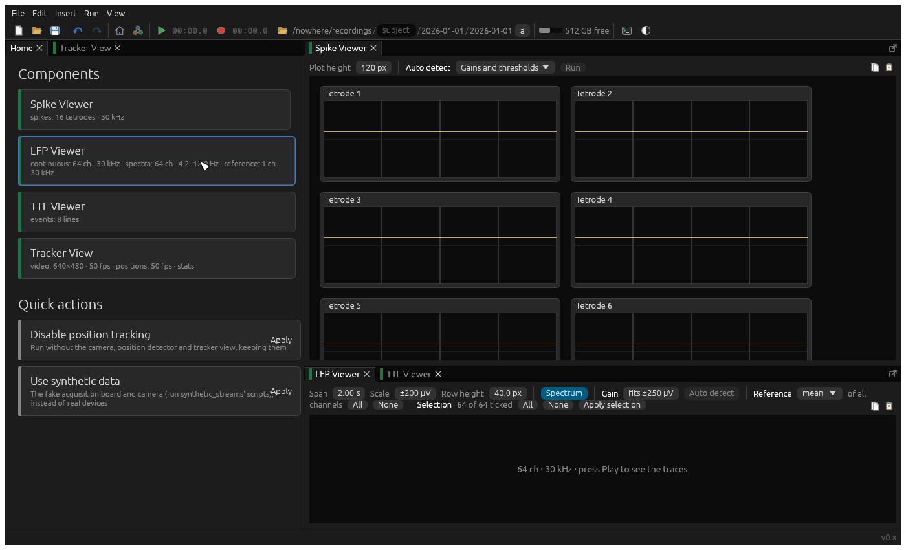

# Quick actions

Quick actions are ready-made changes to the graph, offered in basic mode to people who'd rather not build it node by
node: "Standard LTX graph v0.5", "Disable position tracking", "Use synthetic data".

A [`QuickAction`](../src/core/quick_action.rs) is a name, a description, and a pure function from a
`QuickState` (the graph, with all its settings, and which node windows are open) to a `QuickChange`, or nothing if it
doesn't apply (when it's already been done, say), when it isn't offered. Being a pure function of the graph, it's
undone in one step, and easy to test.

A `QuickChange` is:

- `graph`: the graph to change to.
- `open` and `close`: node windows to open (placed sensibly beside the home pane) and close.
- `panes`: or where to put the panes, replacing the layout (an `Arrangement` of rows, columns and tabs), as the
  standard LTX graph does.
- `arrange`: whether to lay the graph out afresh, as after building it from nothing.
- `summary`: what it did, in a line, which is logged. By convention it says what was added, connected, or changed.

The standard actions are in [`quick_actions.rs`](../src/standard_components/quick_actions.rs), listed in
`QUICK_ACTIONS`, which the program supplies through `Components` ([`main.rs`](../src/main.rs)). Its `Change` helper
reuses what the graph already has (`find`, `upsert`), adds what's missing beside what it follows (`add`), connects
ports that are free (`link`), and sums up what it did (`finish`), so an action applies to a graph that's half there,
and isn't offered once it's all there.
