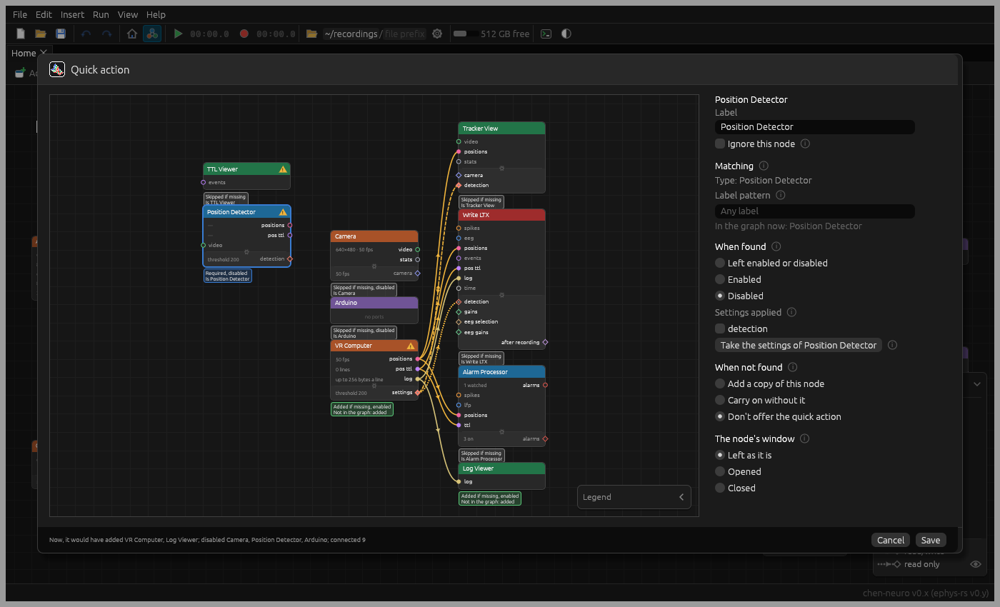

# Quick actions

Quick actions are ready-made changes to the graph, offered in basic mode to people who'd rather not build it node by
node: chen-neuro's "Standard LTX graph", "Use VR computer", "Use synthetic data".


A [`QuickAction`](../src/quick_action.rs) is data, not code, so people can make, change and share their own. A
build ships some, as files listed in `Components::QUICK_ACTIONS` (chen-neuro's are in
[`quick_actions/`](../examples/chen-neuro/quick_actions), each `include_str!`'d by
[`quick_actions.rs`](../examples/chen-neuro/src/components/quick_actions.rs)). People's own are files in a folder beside
the app's settings (`quick_actions/` in eframe's storage directory). Both are listed in Settings › Quick actions.

## What a quick action is

A quick action is a small graph whose nodes are each a **role**, with a rule (`Rule`) for how it's found in the graph
it's done on, and what's done to it:

- **Found**: by the node's type, and optionally a regular expression its label matches (`label_pattern`) and conditions on its settings
  (`conditions`: `{"setting": "low_hz", "op": ">=", "value": 100}`, a dot between names for a setting inside another,
  such as `source.kind`). Each role is one node, never several, and not another role's: of those that fit, the
  left-most on the canvas (of two equally far left, the higher).
- **Mode**: `ensure` (added as the quick action has it, if it isn't found; the default), `if_present` (if it isn't
  found, the quick action is still offered, without it), `require` (if it isn't found, the quick action isn't
  offered) or `ignore` (never looked for, and its edges left alone: in a quick action made from a whole graph, the
  parts that don't matter to it can stay, to show where the parts that do are).
- **What's done**: `settings`, the settings (by name) set as the quick action has them on the nodes found (a node added
  has all of them), and `enabled`, whether they're enabled or disabled (or, without it, left as they are).

Each edge is between roles, by port id, with a mode (`EdgeMode`): `ensure` connects it if the end that takes just one
edge is free (a data stream's input, or the reading end of a value); `replace` connects it, replacing what was there;
`remove` disconnects it; `ignore` leaves it as it is. Nodes are never removed: a quick action disables them, which keeps their settings for when
they're wanted again.

A role's `window` is opened (`{"open": placement}`) or closed (`"close"`), or, without one, left as it is. A window
that's been open before opens where it was; opened for the first time, it goes as the placement says: `"default"`
(where the app puts a new window: see `Layout::place`), `"largest"` (in front, as a tab in the largest group),
`{"behind": role}` (as a tab behind that role's window) or `{"beside": {"of": role, "side": "right", "share": 0.5}}`
(a group of its own on that side of that role's window's group, taking that share of the space). Placed relative to
a window that isn't open, it goes where the app puts a new window. `panes.arrangement` arranges the panes (see
[the layout](#the-layout)), each window by role. `base_directory_type` chooses the
[base directory](base-directories.md) (not while recording), and `arrange_if_empty` lays out a graph built from
nothing afresh.

A quick action is offered while its required roles are found and doing it would change the graph (see
`QuickAction::run`). So one that's done isn't offered until something changes, and closing a window it opened doesn't
bring it back. One that can't change the graph (that only opens and closes windows) is offered while it would change
which windows are open. Doing one is undone in one step.

The roles are found in the order they're listed. A role added goes where it is in the quick action relative to a node
it's connected to that's in the graph, or, with none, below the graph; then down, clear of what's there.

chen-neuro's quick actions show each of these: the standard LTX graph ensures everything, telling the spikes' and the
LFP's band-pass filters (Band-pass High and Band-pass Low) apart by their cut-offs; "Use VR computer" and "Use camera" disable one source, enable the
other, and replace the edges into the tracker view, Write LTX and the Alarm Processor; "Use synthetic data" and "Use
real devices" set `source` on the board and the camera whose `source.kind` is, or isn't, `fake`.

## The file

A quick action's file (`name.quick-action.json`) is shaped as a project, with each node's rule beside it (`"quick"`)
and each edge's mode on it, so the app's [config patches](development.md#config-patches) bring an old one up to date as they would
a project:

```json
{
  "ephys-rs quick action": { "core": "0.310.0", "std": "0.310.0", "chen-neuro": "0.1159.0" },
  "name": "Use synthetic data",
  "description": "The fake acquisition board and camera, instead of real devices",
  "graph": {
    "next_id": 3,
    "nodes": {
      "1": {
        "label": "Acquisition Board", "pos": [0, 0],
        "node": { "type": "AcquisitionBoard", "settings": { "...": "..." } },
        "quick": {
          "mode": "if_present", "settings": ["source"],
          "conditions": [{ "setting": "source.kind", "op": "!=", "value": "fake" }]
        }
      }
    },
    "edges": []
  },
}
```

A quick action with a node type the build doesn't have can't be read, and Settings says so.

## Making and changing them

In Settings › Quick actions, **New from the graph** (or from the nodes selected) makes one from the graph: each node a
role, ensured, setting nothing on what's found; the edges between them, ensured; their open windows, opened. A
build's quick actions can't be changed, but **Duplicate** makes a copy to change.

The editor shows the quick action's nodes and edges as a graph, on a canvas like the app's, most of the window's
size:



- Under each node, how it's found and what's done to it, and what it's found as in the graph now (or that it'd be
  added). Edges that replace what's there are drawn in the warning colour, and those removed in the error colour.
- Nodes are added as on the app's canvas (click the canvas, or a port), or copied from the nodes selected in the
  graph (**Add the nodes selected in the graph**, with the edges between them). Delete, or a node's menu, removes one;
  a node's menu also says how it's found, and an edge's what's done to it. **Arrange** lays them out afresh.
- Beside the canvas, the inspector changes what's selected. For a node: its label; whether it's ignored; how it's
  matched (its type, spelled out, and a label pattern), and what it matches in the graph now; when found, whether
  it's enabled or disabled and which settings are set; when not found, whether a copy is added, the quick action
  carries on without it, or isn't offered; and its window (left as it is, opened, or closed; opened, where it goes
  the first time). For an edge, its mode. With nothing selected, the quick action's name, description, arrangement
  and base directory. Each heading's ⓘ explains the choices under it. Conditions on settings are shown, but only the
  file changes them, for now.
- Ignored nodes and edges are drawn faded.
- **Take the settings of** sets a node's settings from the node it's found as, so one way to change a quick action is
  to do it, change the graph by hand, and take the settings back.
- The footer says what the quick action would do to the graph as it is.

The editor's canvas is the app's (`gui::canvas::Canvas`), drawing the quick action's own graph (`QuickAction::graph`,
put back with `set_graph`). What's different is given by `canvas::Extras`: the badges, the edges' colours, and the
editor's own menus, without annotations, windows or pasting. The app's canvas uses `()`, which adds nothing.

**Copy** puts a quick action on the clipboard, and pasting one (in Settings, or anywhere settings can be pasted) opens
it in the editor, to save. With the files, that's how they're shared.

## The layout

The [`Layout`](../src/layout.rs) of panes (home, the dev tools, the annotation pane and node windows: each a tab
in a group, the groups side by side or one above another) has the helpers the app itself uses to place panes, which
quick actions use on a copy of it:

- `open(id, from)` and `close(id)`: a node's window, opened where it was last, or (the first time) placed by `place`.
- `place(pane, from)`: a step towards the **default layout** (`Arrangement::default_layout`: a column a third of the
  width on the left, the full height; on the right, one group above another, two thirds and a third of the height).
  With one group showing, a new column on its right; with two, the second split, the new one below; after that, a tab
  in the largest group other than the one it was opened from (`from`, if it was opened from a pane).
- `largest_group(except)`, `beside(group)` (the group on its right, or failing that its left), `group_of(pane)`,
  `add_tab(group, pane)`, `split(target, pane, side, share)`: for placing panes otherwise. Sizes are worked out from
  the layout itself (`rects`), so panes placed one after another are placed as they'll be.
- `arrange(arrangement)`: replaces the layout with an `Arrangement` of rows, columns and tabs, the panes it doesn't
  place gathered where it says (`Tab::Others`). The standard LTX graph arranges its viewers in the default layout.
  `arrangement()` gives the layout as it is, as an `Arrangement`, for a quick action to keep.

The app places panes it opens itself the same way: a node's window with `place` (from the pane it was opened from:
the graph, the basic view, or another window); the dev tools as a tab in the largest group; the annotation pane in
the group beside home, or failing that a new column on its right.
