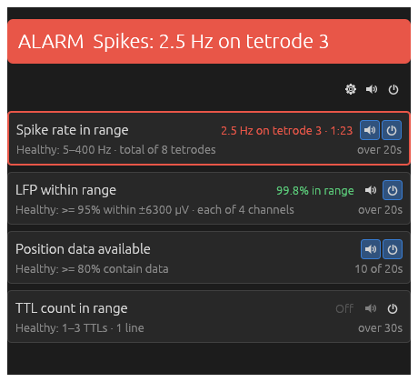
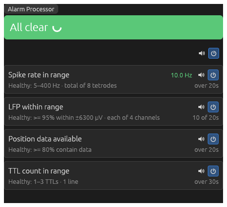
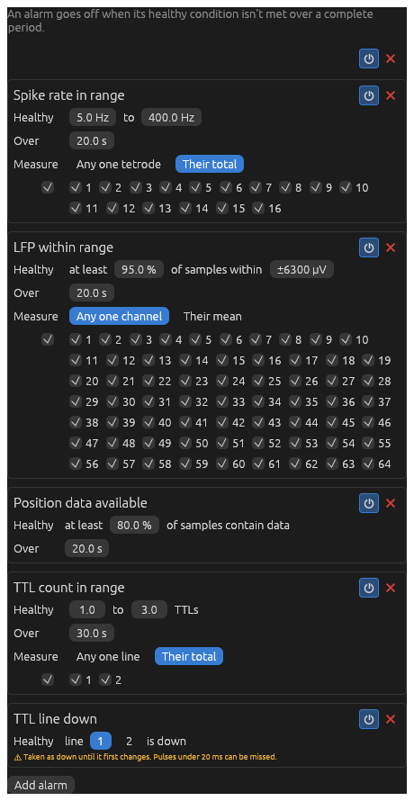
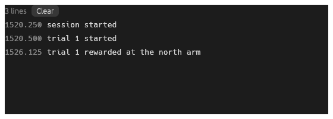

# Alarms and logs

Each component starts with what kind of node it is and its ports: data ports `like this`, settings ports marked ◇.

## Alarms

Alarms say when something coming in looks wrong (spikes stopped, the LFP saturating, the tracking lost) so it's
noticed during a recording rather than after it. An **Alarm Processor** watches the data, and an **Alarm Viewer** shows
how each alarm stands, and can sound them. Connect the processor's `alarms` output and ◇ `alarms` setting to the
viewer.

### Alarm Viewer

> **Viewer.** In: `alarms` (alarm states). ◇ `alarms` (the Alarm Processor's).

 

A banner, large enough to see from across the room: red with what's wrong, or green when all's clear. Below it, each
alarm, with what's healthy, how it stands now, and over what period. Each has buttons to switch it on and off, and to
sound it or not. The buttons at the top do it for all of them. The cog opens the Alarm Processor's settings, in basic
mode too.

An alarm doesn't go off until it's seen a whole period. Until then, its period counts up ("10 of 20s"), and the banner
shows it's waiting.

Alarms only **sound** while recording, as what's wrong before then needn't fill the room: a few pips, at a pitch for
what's wrong. An alarm still going off pips again, more each time, in case the first were missed.

### Alarm Processor

> **Processing.** In: `spikes`, `lfp` (continuous), `positions`, `ttl` (events). Out: `alarms`. ◇ `alarms`.

Measures what comes in over each alarm's period, and says whether it's healthy. **Add alarm** to add one of:

| Alarm | Healthy when |
| --- | --- |
| Spike rate in range | The spike rate is in a range: on any one tetrode, or their total. |
| LFP within range | At least a percentage of samples are within ±µV: on any one channel, or their mean. |
| Position data available | At least a percentage of positions contain data (an LED was found). |
| TTL count in range | The number of TTLs is in a range: on any one line, or their total. |
| TTL line down | A line is down. Pulses under 20 ms can be missed. |

Each has its **period** (**Over**), and which tetrodes, channels or lines it watches. An input only needs connecting if
an alarm watches it.

While recording, the graph can't change, so an alarm switched off then is only ignored until recording stops. An alarm
that was off when recording started can't come on until it stops.

## Log Viewer

> **Viewer.** In: `log` (log lines).

Lines of text as they come from a source (a VR computer's task, say), each with its time in seconds by that source's
clock. **Clear** empties it. Write LTX records log lines too, in its `.txt` file.
