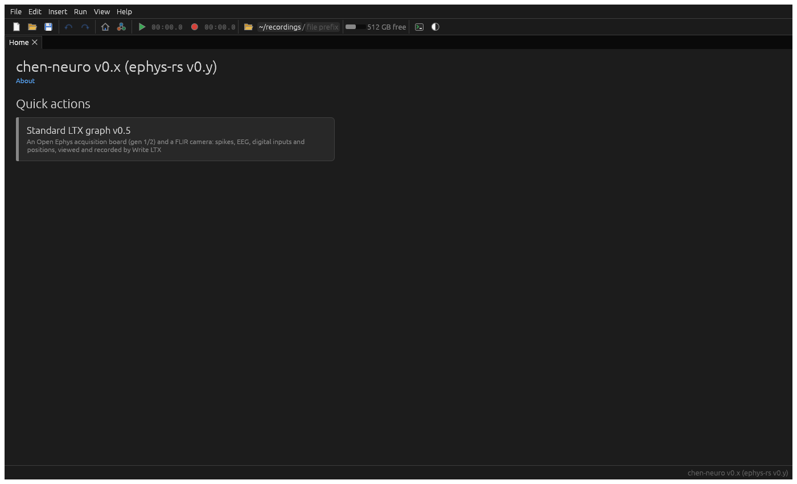
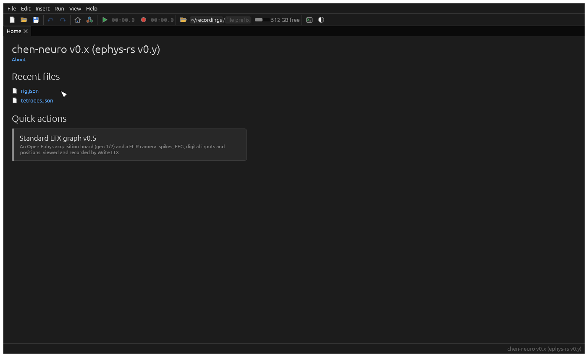
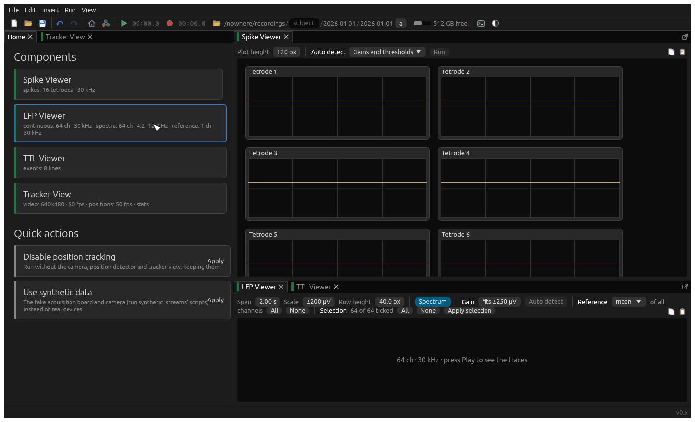
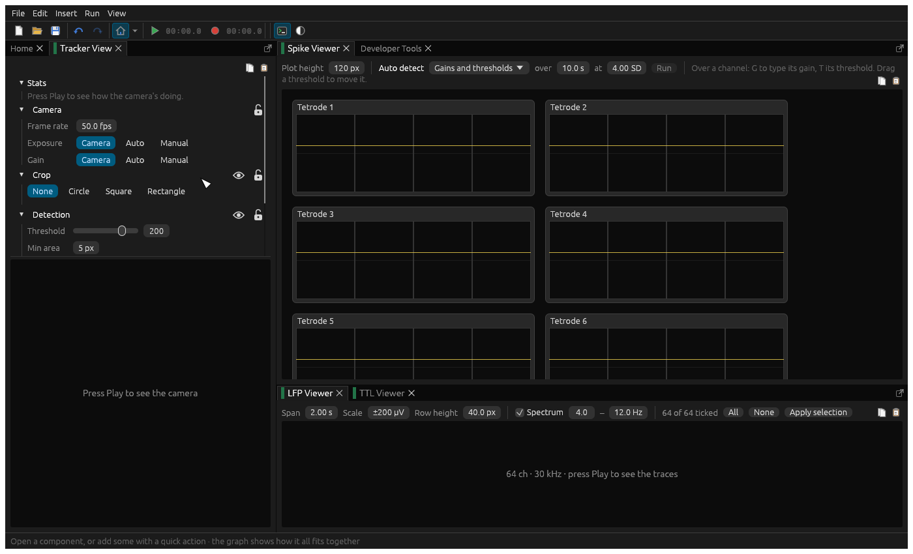
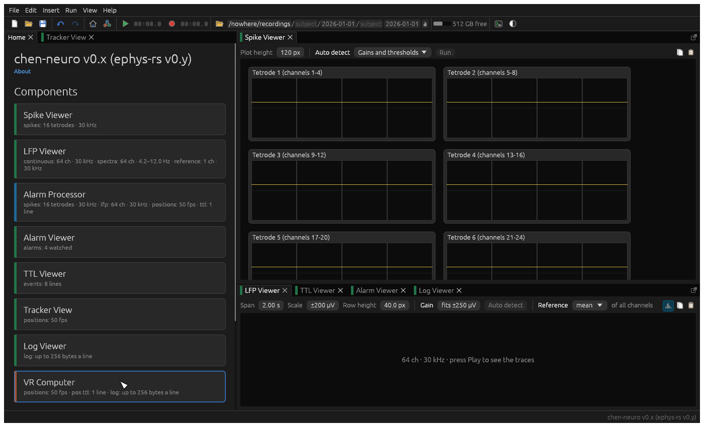

# Basic mode

Basic mode is for running experiments without thinking about the graph. It's where ephys-rs starts.

## Starting out

With nothing set up, the home pane offers your recent files, and the *quick actions* your build has. A quick action
is a ready-made change to the setup. Chen-neuro's "Standard LTX graph" adds a whole tetrode rig in one click: an
acquisition board and a camera, with spikes, EEG, digital inputs and positions viewed and recorded, and each
recording's positions put on the board's clock once it's written; and an Arduino, setting its pin 8 high while
acquiring, once its port is chosen in its settings (it never guesses which Arduino). Your lab's build will have its
own.

## Once it's set up

Once there's a setup, the home pane lists its components, each as a large button: by default the viewers (green).
Click one to open its window beside the home pane. A quick action usually opens the ones you need for you:

Below them are the quick actions that still apply, which change the setup from here. Chen-neuro's "Use VR computer",
for example, swaps the camera for positions from a VR computer. Each can be undone (Ctrl/⌘ Z) in one step.

Then use **Play** and **Record** in the toolbar, as in [a typical session](README.md#a-typical-session).

## What basic mode leaves out

In basic mode, windows don't have the buttons that change the graph (deleting a node, disabling it, or choosing what
shows in basic mode), so the setup can't be broken by accident. Settings can still be adjusted, and copied and
pasted. Everything else is in [advanced mode](graph.md), a click away on the toolbar's graph button (Ctrl/⌘ 1).

To have a node that isn't a viewer show in basic mode (an Alarm Processor, say, to adjust its alarms), right-click it
on the graph and tick **Show in basic view**.
