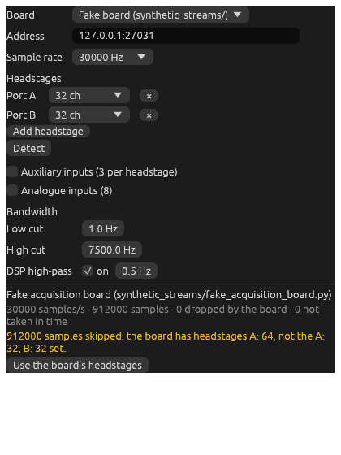
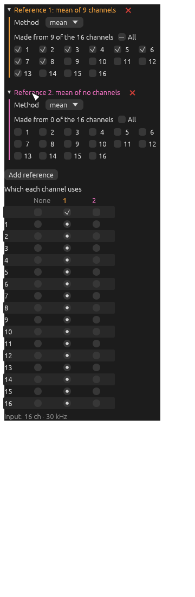
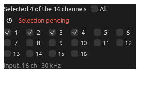
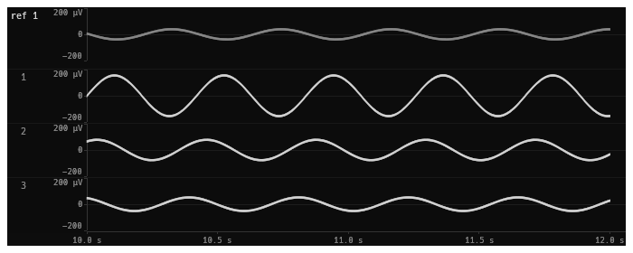
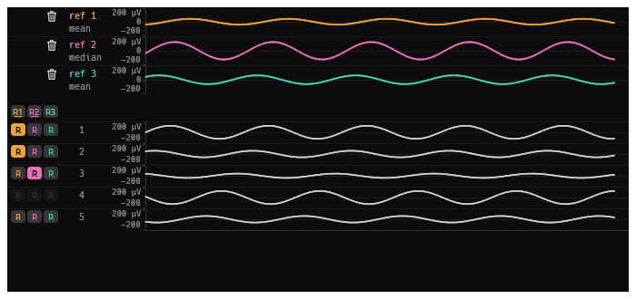
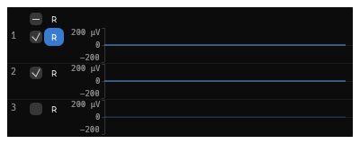
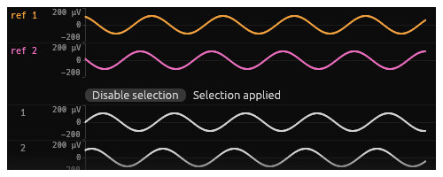
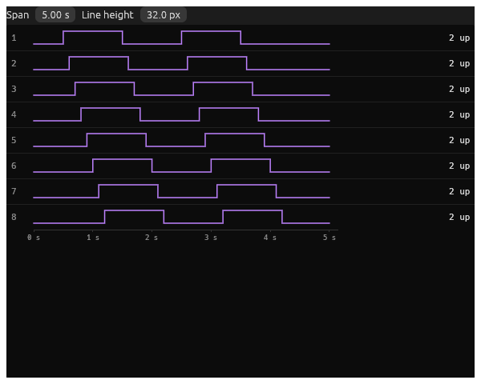

# Electrophysiology

Continuous voltages and digital inputs from an acquisition board: re-referenced, filtered, downsampled, scaled and
viewed. For spikes, see [Spikes](spikes.md).

Each component below starts with what kind of node it is and its ports. Data ports are written `like this`, and
settings ports are marked ◇.

- [Acquisition Board](#acquisition-board)
- [Reference](#reference)
- [Channel Selector](#channel-selector)
- [Band-pass Filter](#band-pass-filter)
- [Downsample](#downsample)
- [Continuous Gain](#continuous-gain)
- [Spectrum](#spectrum)
- [LFP Viewer](#lfp-viewer)
- [TTL Viewer](#ttl-viewer)

## Acquisition Board

> **Source.** Out: `headstages` (continuous, µV), `digital` (events), and, if they're on, `auxiliary` and `analogue`
> (continuous).

Samples from an acquisition board's headstages, and its digital (TTL) inputs, all sampled together. The board can be:

- an **Open Ephys Acquisition Board** (generations 1 and 2, on Opal Kelly FPGAs, or generation 3, over USB 3);
- an **Intan RHD USB Interface Board**;
- the **fake board** in `synthetic_streams/`, for trying things without hardware.

The real boards use the libraries and bitfiles of the Open Ephys GUI's acquisition board plugin: install the Open
Ephys GUI and the plugin (and its Intan RHD USB plugin, for Intan's board), and ephys-rs uses them from the GUI's
folder. File › Settings… › **Open Ephys** shows which file each board uses, lets you choose another folder, and links
to each file, to download on its own instead (see [Settings](main-window.md#settings)). The generation 3 board needs
the plugin's liboni as a library of its own, which it is up to version 1.1.

**Settings**

- **Sample rate**.
- **Headstages**: the channels on each port. **Detect** asks the board which headstages are plugged in. If what
  arrives doesn't match (as above), it says so, and **Use the board's headstages** fixes it.
- **Auxiliary inputs**: each headstage's three auxiliary inputs (accelerometers, say), as an output of their own.
- **Analogue inputs**: the board's 8 analogue inputs, likewise.
- **Bandwidth**: the headstages' own analogue filters (low and high cut), and their DSP high-pass.

Below the settings is what the board's doing: samples per second, how many have come, and how many were dropped or
didn't arrive in time.

## Reference

> **Processing.** In: `continuous`. Out: `referenced` (the channels, each less its reference), `reference` (the
> references themselves, a channel each). ◇ `reference`.

Re-references channels: as Open Ephys's common average reference, but with any number of references. Each reference
is the **mean** or **median** of some channels. The median is barely moved by a spike on one of its channels. Each
channel then has subtracted from it the reference it uses, if any. A reference made of one channel is that channel.

**Settings**

- For each reference: mean or median, and which channels it's made from.
- **Which each channel uses**: a reference, or none.

The references can also be chosen from an [LFP Viewer](#lfp-viewer), connected to the ◇ `reference` setting, while
looking at the traces.

## Channel Selector

> **Processing.** In: `continuous`. Out: `selected`. ◇ `selection`.

Passes on some of a stream's channels (which channels are kept for the EEG, say). It passes on all of them while the
selection's off (the power button), so you can look through them all, then choose. The selection can be chosen from an
[LFP Viewer](#lfp-viewer) connected to ◇ `selection`.

## Band-pass Filter

> **Processing.** In: `continuous`. Out: `filtered`.

A Butterworth band-pass filter on every channel, as Open Ephys's filter has. Typically 600–6000 Hz before spike
detection, or a lower band for the LFP.

**Settings**: **Low cut-off**, **High cut-off** (Hz), and **Order**.

## Downsample

> **Processing.** In: `continuous`. Out: `downsampled`.

Continuous data at a lower **Rate**, keeping every so many samples: every 6th, from 30 kHz to 5 kHz, say, for Write
LTX's EEG. It doesn't filter, so filter out what's above half the new rate first, with a Band-pass Filter. Otherwise
it aliases.

## Continuous Gain

> **Processing.** In: `continuous` (µV). Out: `scaled` (amplified µV). ◇ `gains`.

Amplifies each channel by a gain, as an amplifier does: ×1 leaves it as it is, ×2 doubles it. That's all a gain does:
what's recorded is up to whatever records it (Write LTX's EEG [scale](recording.md#write-ltx) maps ±250 µV to its −128
to 127, to begin with). Gains go from ×¼ to ×4, and can be **one for** all channels, or one each.

**Auto detect** chooses gains from the data: it samples each channel **for** a while, then sets each gain so that the
mean plus a multiple of a percentile's distance from it (the **Level**) just **fills** what's recorded (±250 µV, to
begin with). Run it from here, or from an [LFP Viewer](#lfp-viewer) connected to ◇ `gains`.

## Spectrum

> **Processing.** In: `continuous`. Out: `spectra`.

Each channel's power spectrum over a **Band** of interest (theta, 4–12 Hz, to begin with), updated every few passes,
for an LFP Viewer to show beside its traces. It only runs while the viewer's showing them.

## LFP Viewer

> **Viewer.** In: `continuous`, `spectra` (from a Spectrum), `reference` (from a Reference's `reference` output).
> ◇ `gains` (a Continuous Gain's), ◇ `selection` (a Channel Selector's), ◇ `reference` (a Reference's).

Scrolling traces of continuous data, a row per channel, with the time along the bottom. Each row keeps the highest and
lowest sample in each pixel's worth of time, so spikes show however far it's zoomed out.

**Toolbar**: **Span** (seconds shown), **Scale** (±µV, the rows' y axes), **Row height**. With a gain connected, the
gain (one for all, ×) and their auto detect: the traces are what comes in, in µV, before it. With a reference
connected, the references.

Connected to other nodes' settings, it sets them while you look at the traces:

**Choosing references** (◇ `reference`): a column of Rs for each reference sits left of the channels' numbers.
Click a channel's R to put it in that reference and have it use it. Connected to the Reference's `reference` output too,
it shows each reference's own trace, in its colour, at the top. A dimmed row of Rs is a channel that settings say
otherwise for.

**Choosing channels** (◇ `selection`): while the selection's off, all channels show. Click the numbers of those to
keep, then **Apply selection**. **Disable selection** shows them all again.

 

## TTL Viewer

> **Viewer.** In: `events`.

Each digital input line's level over the last few seconds, a row per line. On the right is how many times it's gone
up, since acquisition started and since recording last started. Use it to check that TTLs from other equipment (a
timing LED's, a VR computer's) are arriving. **Settings**: **Span**, **Line height**.
