# The graph

In advanced mode (the toolbar's graph button, or Ctrl/⌘ 1), the home pane shows the *graph*: every part of the setup,
as boxes (nodes) joined by wires (edges). Data flows left to right, from sources to writers.

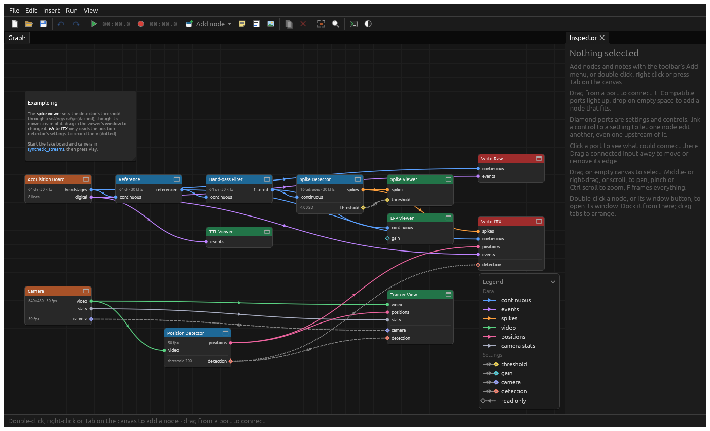

## Nodes

Each node does one thing, and its header's colour says what kind of thing:

| Colour | Kind | Examples |
| --- | --- | --- |
| Orange | Sources: where data comes from | Acquisition Board, Camera |
| Blue | Processing | Reference, Band-pass Filter, Spike Detector |
| Green | Viewers | LFP Viewer, Spike Viewer, Tracker View |
| Red | Writers: what records | Write LTX, Write Raw |

Under its name, a node summarises what it's handling ("64 ch · 30 kHz", "16 tetrodes · 30 kHz") and its main
settings ("50 µV (all)").

**Open a node's window** by double-clicking it (or clicking it once it's selected). Viewers' windows are their views.
Other nodes' windows show their settings, any problems, and what each port carries and is connected to:

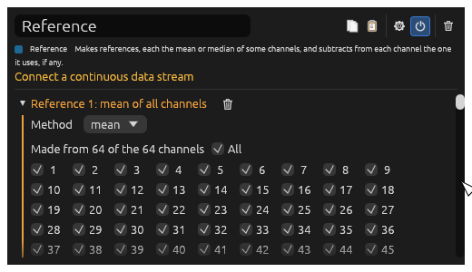

Along the top of every node's window are buttons to copy and paste its settings, a cog for its options (such as
whether it shows in basic mode), a power button to disable it, and a bin to delete it.

**Right-click a node** to rename it, choose whether it shows in basic mode, open its window, duplicate, disconnect,
disable or delete it, or copy and paste its settings.

## Ports and edges

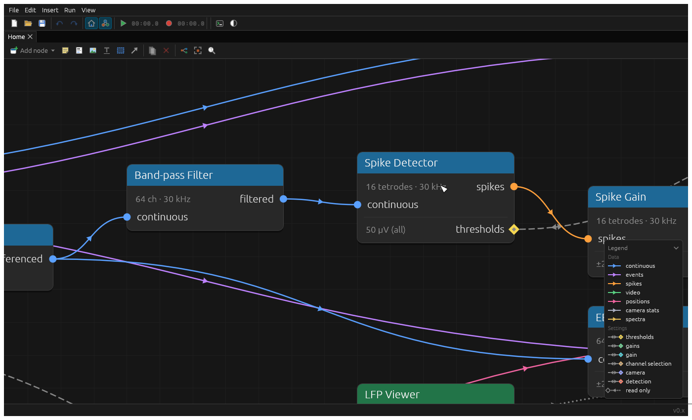

A node's *data ports* are the round dots: inputs on its left, outputs on its right. Each kind of data has a colour,
listed in the legend in the corner: continuous voltages (blue), events such as TTLs (purple), spikes (orange), video
(green), positions (pink) and so on. Only ports of the same kind can be connected.

**To connect**, drag from one port to another. While you drag, the ports it could go to stand out and the rest of the
graph fades:

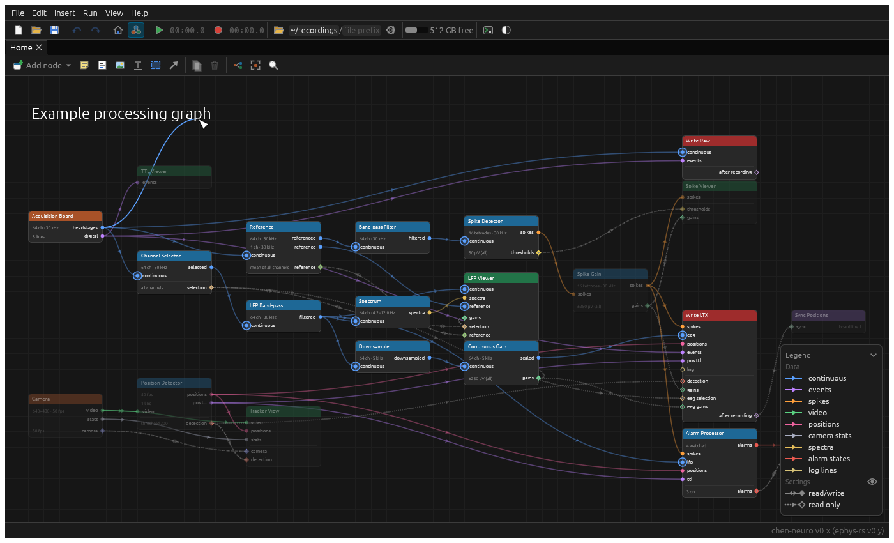

Drop it on empty canvas, or click a port, to get a menu of the node types that could connect there (and the ports
already in the graph that could). Pick one, and it's added and connected:

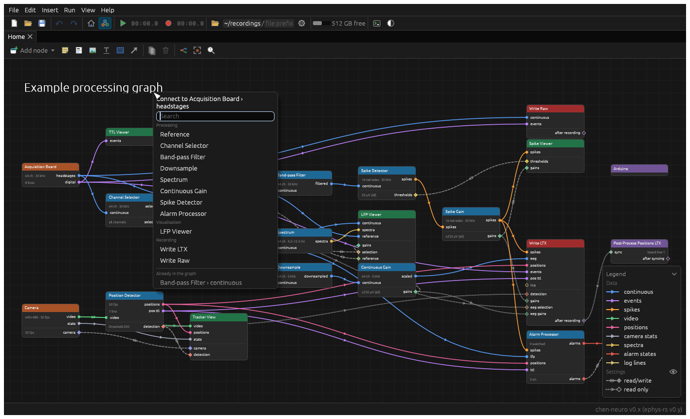

**To move an edge**, drag it away from the input it goes into. Drop it on another input, or on nothing to remove it.
**Right-click an edge** to disable or delete it.

An output can feed any number of inputs; an input takes one edge.

### Settings edges

Below the data ports, separated by a line, are the *settings ports*, the diamonds. They let one node adjust or read
another's settings. A Spike Viewer connected to a Spike Detector's `thresholds`, for example, lets you drag the
thresholds in the viewer. And Write LTX connected to a Spike Gain's `gains` records the gains in its files.

Settings edges are grey and dashed, and usually run back upstream. They run the other way round to data: the setting
is on the right of the node it belongs to, and the control that edits it is on the left of the node editing it. A
dotted edge to a hollow diamond is *read only*: the node reads the setting, but can't change it.

The eye in the legend hides settings ports and edges, for a simpler picture of how the data flows:

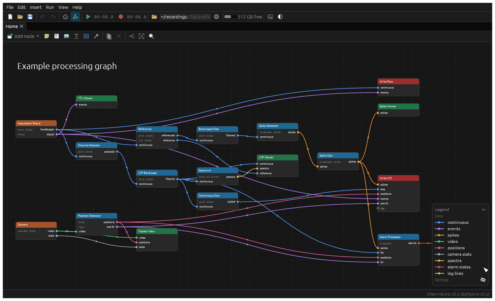

## Adding nodes

Use the graph toolbar's **Add node**, the Insert menu, or press Tab over the graph, and pick a type. Or double-click,
or right-click, empty canvas to add one there. Or drag from a port, as above, to add one already connected.

Which node types are offered can be chosen in [Settings](main-window.md#settings).

## Selecting, moving and arranging

- Click to select; Shift-click to add to the selection; drag on empty canvas to select everything in a rectangle.
- Drag a node to move it (and everything selected with it).
- Drag with the middle or right button, or scroll, to pan. Pinch, or Ctrl-scroll, to zoom.
- **Arrange nodes** (in the graph toolbar, or Edit › Arrange Nodes) lays the graph out in columns, the way data flows.
- **Frame all** (F) fits the graph to the pane; **Actual size** zooms to 100%.

## Disabling

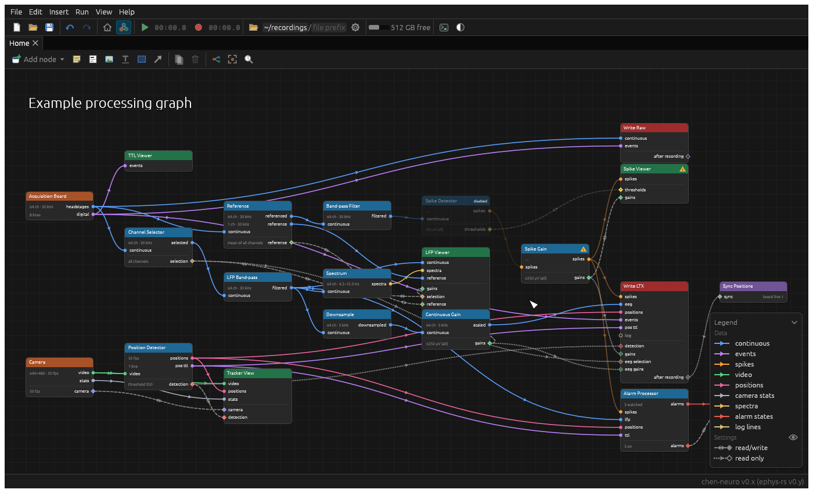

A disabled node (Ctrl/⌘ E, its window's power button, or right-click › Disable) stays in the graph with its settings,
but the graph runs as if it weren't there. Use this to leave out part of a setup for a while (the camera, say) without
losing how it was set up. Edges can be disabled too, from their right-click menu. A disabled edge is drawn broken in
the middle.

## Copying and pasting settings

Copy a node's settings (Ctrl/⌘ Alt C, or the copy button in its window), then paste them (Ctrl/⌘ Alt V) onto a node
of the same type: in this setup, or another one. Pasting shows what will change, and where each copied node's settings
go, before anything does:

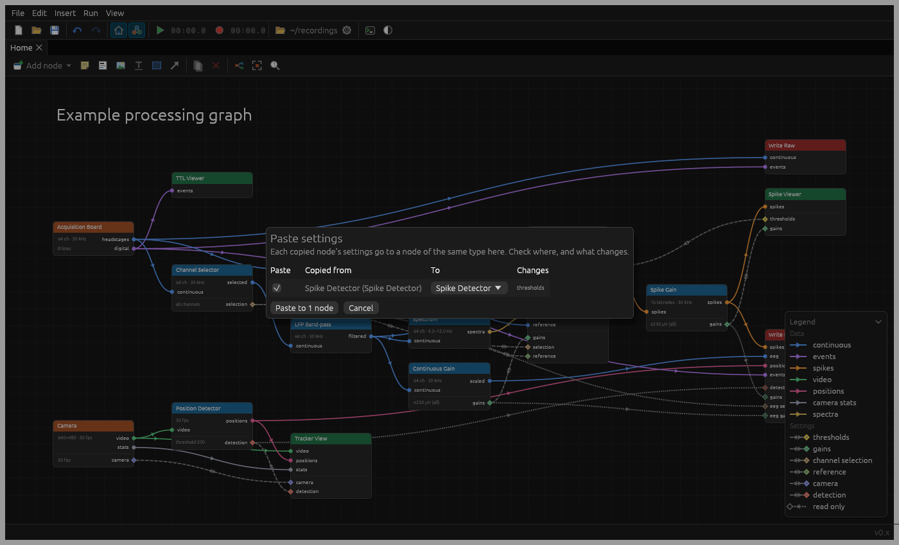

Settings are copied as text, so they can be kept in your notes, or sent to someone, and pasted from there.

## Windows

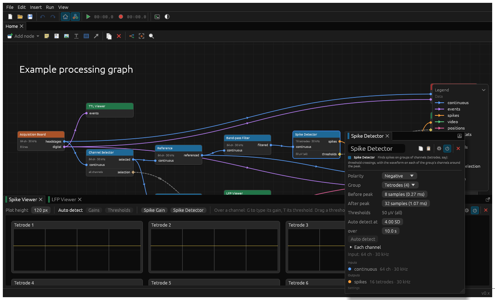

Node windows open docked beside the graph, as tabs. Drag a tab to rearrange them: beside, above or below another, or
in with it as another tab. The button at a group's top right floats a window. Closing a window keeps its place, so it
comes back where it was. View › Reset Layout puts everything back.

## Notes on the canvas

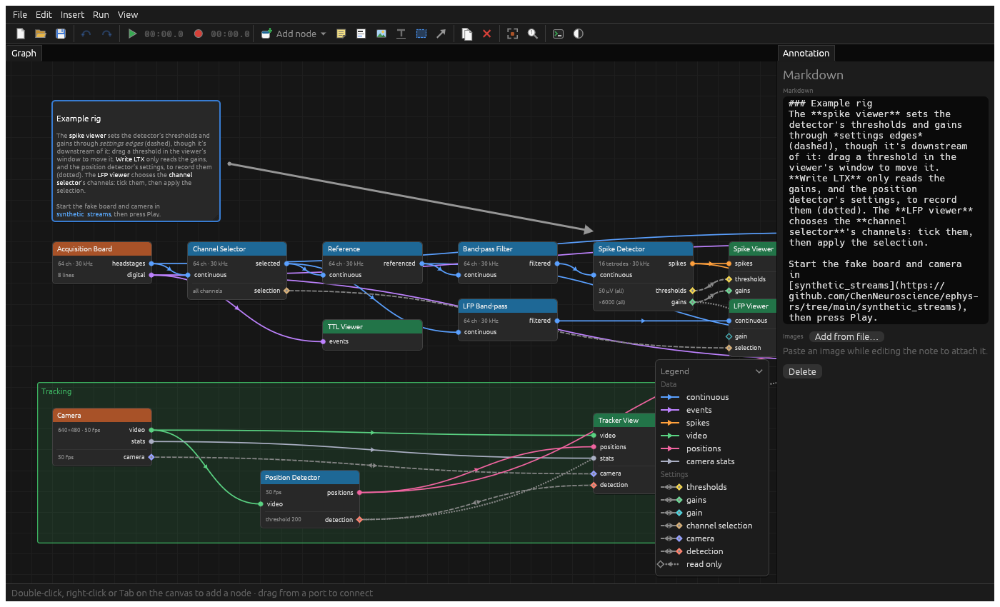

The graph toolbar's drawing tools add things to the canvas that aren't part of the graph, to explain a setup to
whoever uses it next. They're saved with it. Pick a tool, then drag out where it goes (or click, for its usual size):

- **Sticky note**: plain text, on coloured paper.
- **Markdown**: formatted text: headings, bold, lists, links, and images pasted in. The cheat sheet under the editor
  says how.
- **Image**: from a file. Or just paste an image (Ctrl/⌘ V) onto the canvas.
- **Heading**: large plain text, like "Example processing graph" above.
- **Box**: a tinted box behind nodes, to group them, with a title.
- **Arrow**: a thick arrow, to point something out.

Double-click one to edit it. Its settings open in a pane beside the graph.

## Themes

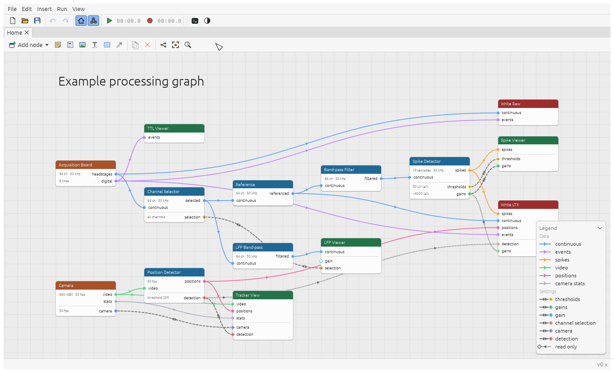

The toolbar's theme button switches between dark and light.
