# The main window

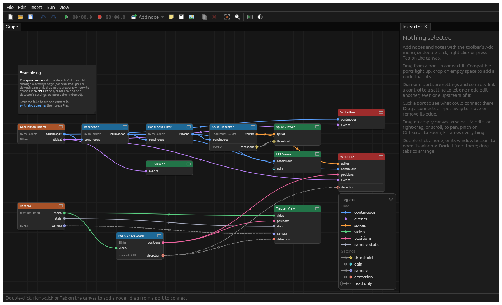

Along the top are the menus and the main toolbar. Below them are the panes: the home pane (the basic view or the
graph), and any windows you've opened. At the bottom is the status bar, which shows the version and any problems.

## The toolbar

From left to right:

| Button | What it does |
| --- | --- |
| New, Open, Save | Start a new setup, open one, save this one. A setup is saved as a `.json` file: the graph, every node's settings, and notes on the canvas. |
| Undo, Redo | Undo or redo changes to the graph and to settings. |
| Home | Basic mode: the [basic view](basic-mode.md). |
| Graph | Advanced mode: [the graph](graph.md). |
| ▶ Play, and a time | Start or stop acquiring. The time is how long it's been running. |
| ● Record, and a time | Start or stop recording. The time is how long it's been recording. Starts acquiring too, if it isn't already. |
| 📁 and a path | [Where recordings go](#where-recordings-go). |
| A bar and "GB free" | How full the disk recordings go to is. |
| Console | The [developer tools](#developer-tools). |
| Theme | Dark or light. |

### Playing and recording

**Play** starts acquiring: sources (boards, cameras) start sending data, everything downstream processes it, and the
viewers show it. Nothing is written to disk. Use this to check everything before recording.

**Record** starts writing, through every writer node in the graph (Write LTX, Write Raw). Press it again to stop
recording. Acquisition carries on. Stopping acquisition (Play) stops recording too.

While recording, the graph can't change: nodes can't be added, removed, connected or disabled, so what's recorded
stays the same from start to finish.

## Where recordings go

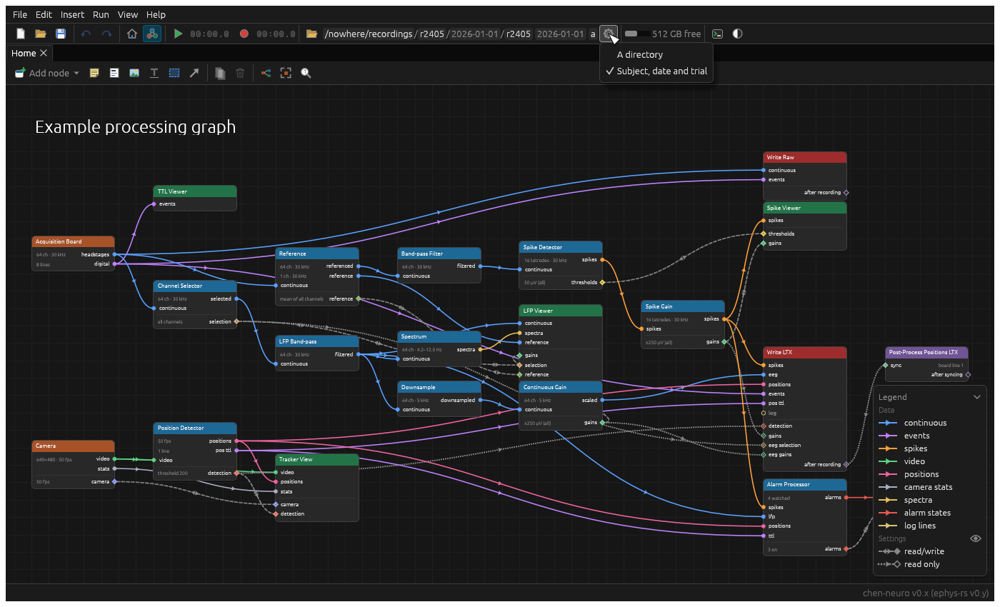

The section after the folder icon says where the next recording will go: a *base directory*, and perhaps a prefix
for the file names. Click the folder to choose the directory, and type the prefix after it. Every writer writes there,
so you choose it once for all of them.

In advanced mode, the cog beside it chooses how recordings are named. ephys-rs comes with **A directory**, a
directory and an optional file prefix. Your lab's build may add others. Chen-neuro adds **Subject, date and trial**,
for example, which files each recording by subject and day and numbers the trials for you, as above.

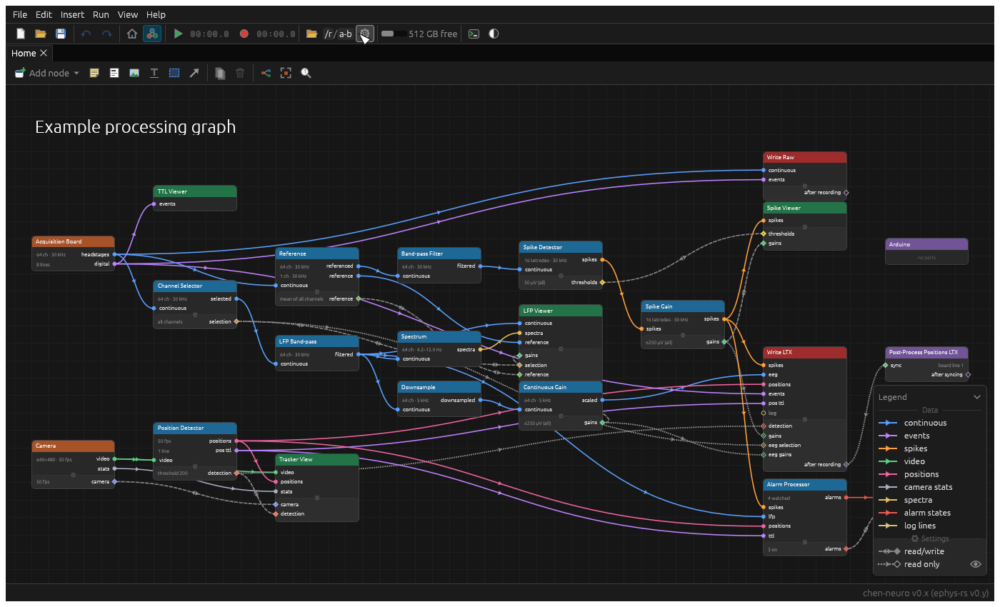

## Settings

File › Settings… (Ctrl/⌘ ,) has the app's preferences, kept between sessions:

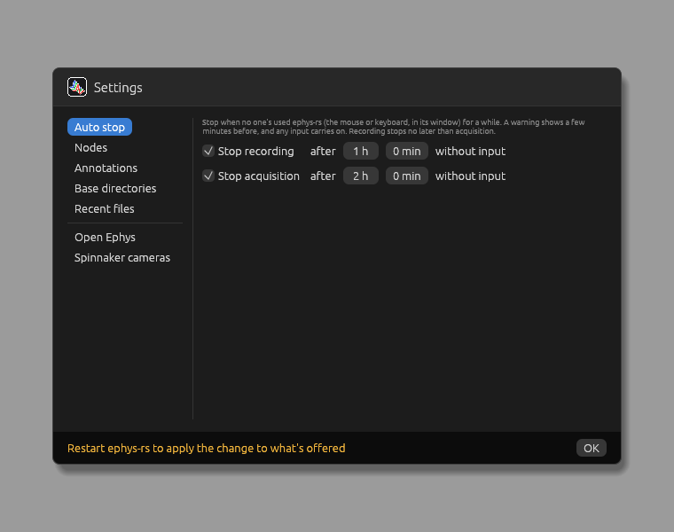

- **Auto stop**: stop recording, and acquisition, when no one's used ephys-rs (the mouse or keyboard, in its window)
  for a while. This is so a forgotten session doesn't fill the disk overnight. A warning shows a few minutes before,
  and any input carries on. Recording stops no later than acquisition.
- **Nodes**, **Annotations**, **Base directories**: which types are offered, so you can hide those your lab doesn't
  use. What's already in a graph stays. Applies from the next start.
- **Recent files**: how many to keep in File › Open Recent and the basic view, and a button to clear them.

Below those, a tab for each kind of hardware whose files come from elsewhere. These are for this machine, not saved
with a graph.

- **Open Ephys**: the acquisition boards' libraries and bitfiles are the Open Ephys GUI's. The tab shows the folder
  they come from (the GUI's own, or one you choose), and which file there each board uses, with a link to get each on
  its own, if you'd rather not install the GUI.
- **Spinnaker cameras**: folders to look in first for FLIR's Spinnaker SDK, whether it's found, and where to get it.

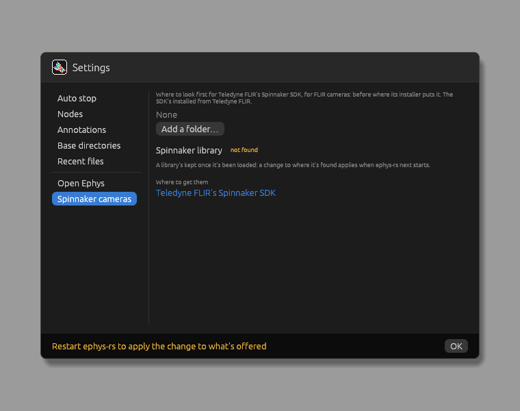

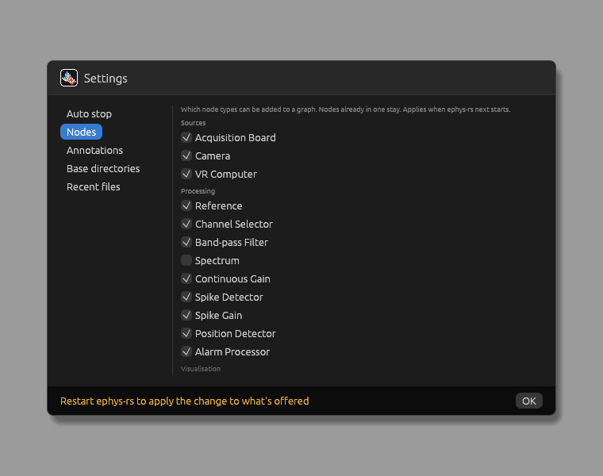

When auto stop is about to act, it warns you, and once it has, it says so:

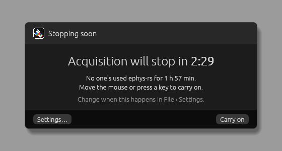 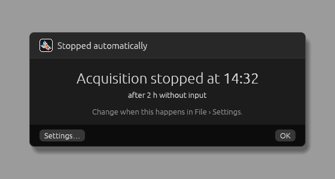

## Problems

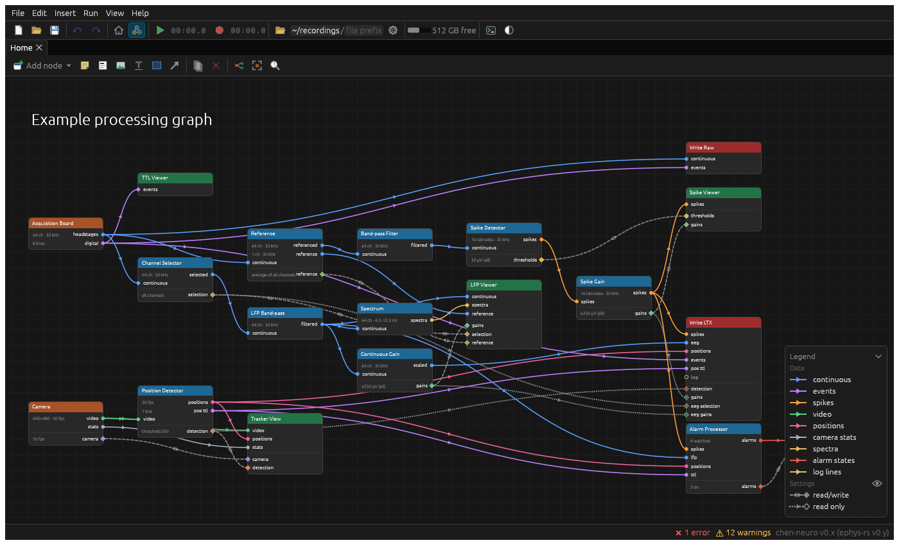

When something's wrong (a node isn't connected, a device can't be found, settings don't agree), the node shows a ⚠ on
the graph, and the status bar counts the errors and warnings. Hover over a node's ⚠ to see what it is, or open the
node's window, which lists its problems at the top. Clicking the count brings the developer tools to the front, with
just the console open. The console's **Clear** clears the count too.

## When it crashes

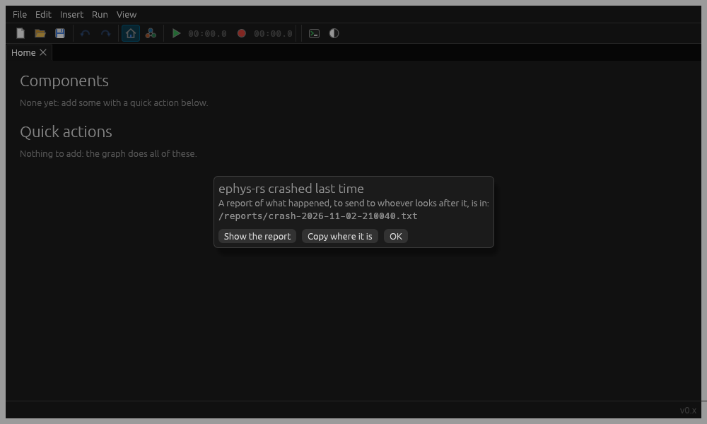

If ephys-rs crashes, it writes a report of what happened, and says where it is the next time it starts. Send that
report to whoever looks after your build: it says what was running, which is what's needed to fix it.

## Developer tools

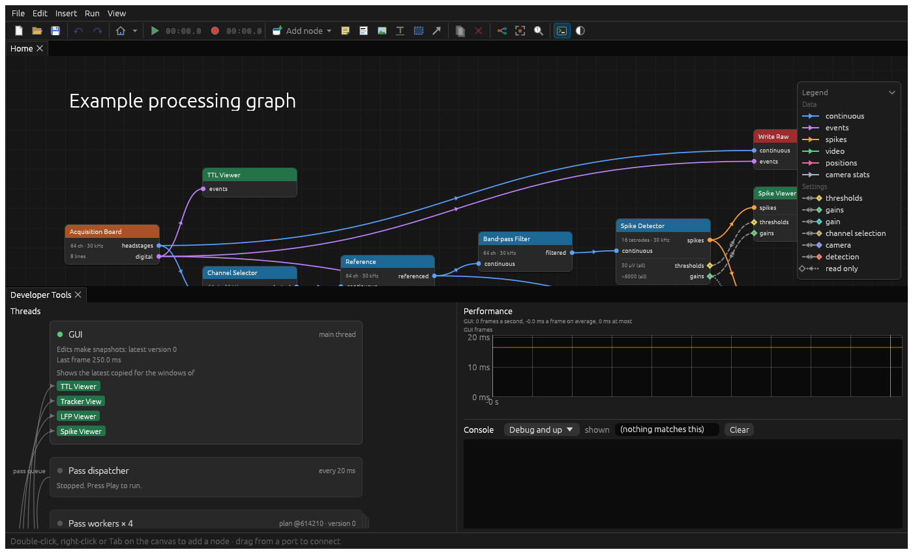

Ctrl/⌘ Alt I (or the console button) opens the developer tools: what each thread is doing, how long each step takes,
and the console, which logs what ephys-rs is doing. Only the console's open at first: click a section's header to
open or close it. You won't need them day to day. When a device misbehaves, the
console is the first place to look, and copying from it is the best way to report a problem.

## Keyboard shortcuts

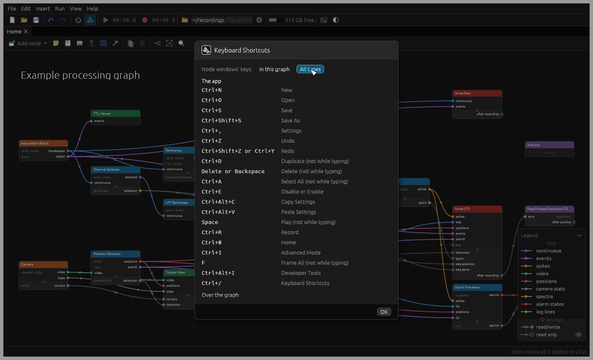

Help › Keyboard Shortcuts (Ctrl/⌘ /) lists them all: the app's, the graph's, and the keys node windows answer to
(those of the nodes in the graph, or of every type). Ctrl on Windows and Linux is ⌘ on macOS.

| Shortcut | Does |
| --- | --- |
| Space | Play or stop |
| Ctrl/⌘ R | Record or stop recording |
| Ctrl/⌘ N, O, S | New, open, save |
| Ctrl/⌘ Shift S | Save as |
| Ctrl/⌘ Z | Undo |
| Ctrl/⌘ Shift Z, or Ctrl/⌘ Y | Redo |
| Ctrl/⌘ 0 | Basic mode (home) |
| Ctrl/⌘ 1 | Advanced mode (the graph) |
| Tab, over the graph | Add a node |
| Ctrl/⌘ D | Duplicate what's selected |
| Delete or Backspace | Delete what's selected |
| Ctrl/⌘ A | Select all |
| Ctrl/⌘ E | Disable or enable what's selected |
| F | Frame all: fit the graph to the pane |
| Ctrl/⌘ Alt C | Copy settings |
| Ctrl/⌘ Alt V | Paste settings |
| Ctrl/⌘ , | Settings |
| Ctrl/⌘ Alt I | Developer tools |
| Ctrl/⌘ / | Keyboard shortcuts |

Space, Delete, Ctrl/⌘ D and F do nothing while you're typing in a text box.
