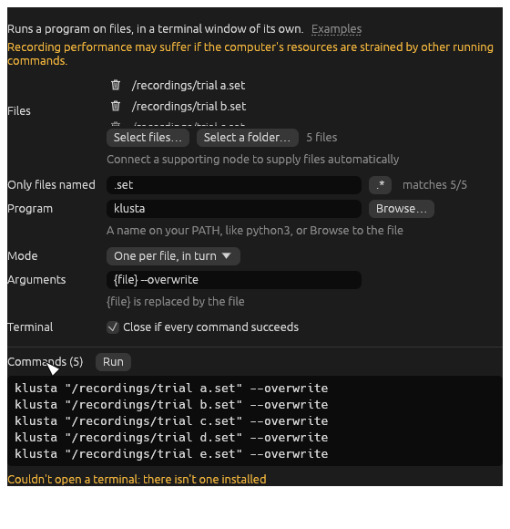
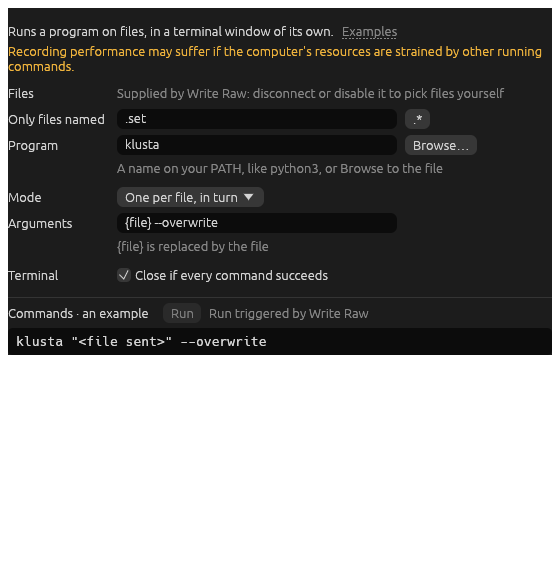
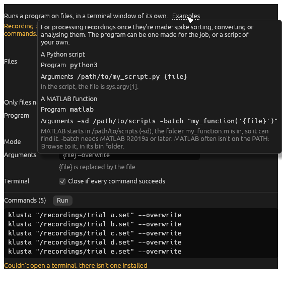
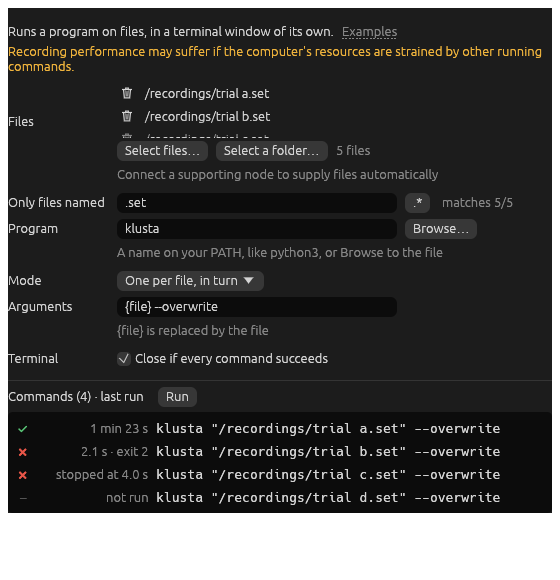
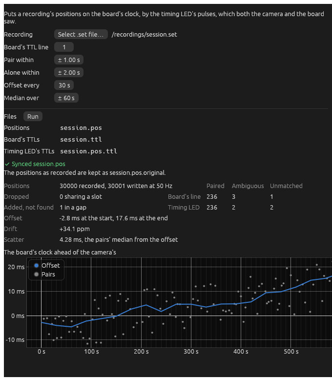
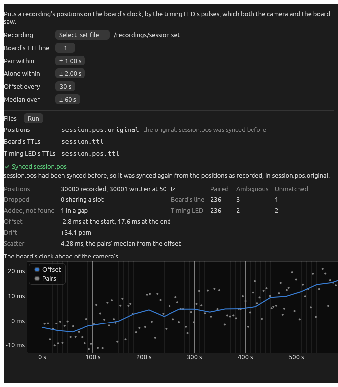

# Recording

Writers record what's connected to them while ephys-rs is recording (the toolbar's **Record**). They write in the
[base directory](main-window.md#where-recordings-go) chosen in the toolbar, with its file prefix. Or each can write in
a **Subdirectory** of it, or a **Directory** of its own (its **Writes in** setting).

Each component starts with what kind of node it is and its ports: data ports `like this`, settings ports marked ◇.

## Write LTX

> **Writer.** In: `spikes`, `eeg` (continuous), `positions`, `events`, `pos ttl`, `log`. ◇ `detection` (a Position
> Detector's), ◇ `gains` (a Spike Gain's), ◇ `eeg selection` (a Channel Selector's), ◇ `eeg gains` (a Continuous
> Gain's), all read only. ◇ `after recording`.

Records in the [LTX format](https://github.com/ChenNeuroscience/ltx-format), as the Open Ephys LTX plugin writes it,
for tetrode analysis code and [Waveform](https://chenneuroscience.github.io/waveform/). For a recording called `name`:

| File | What's in it | Comes from |
| --- | --- | --- |
| `name.set` | Headers: the settings, gains and channels | the settings connected |
| `name.1`, `name.2`... | Each tetrode's spikes, 50 samples a channel | `spikes`, from a Spike Gain (−128 to 127) |
| `name.egf`, `name.egf2`... | Each EEG channel, at 5 kHz | `eeg`, from a Downsample then a Continuous Gain (−128 to 127) |
| `name.pos` | Both LEDs' positions and sizes | `positions`, from a Position Detector |
| `name.ttl` | Digital input changes | `events` |
| `name.pos.ttl` | The timing LED's changes | `pos ttl`, from a Position Detector |
| `name.txt` | Log lines | `log` |

Connect its read-only settings so the files say what they hold: the spikes' and EEG's gains, which channels the EEG
is, and the tracking's crop and calibration. Without them, the headers leave them out. Its window says which aren't
connected, and it warns if what's connected doesn't suit LTX (spikes not in tetrodes, or EEG not at 5 kHz).

## Write Raw

> **Writer.** In: `continuous`, `events`. ◇ `after recording`.

Records continuous data and digital inputs as they come, in the Open Ephys binary format, which the Open Ephys analysis
tools (and anything reading NumPy files) can load. Each recording is a folder (its window shows what it'll be called,
from its **Folder prefix** and the base directory), laid out as the Open Ephys GUI's are: `structure.oebin`, then `continuous/` (16-bit samples, with each
sample's number and time) and `events/` (each TTL change).

## Run Command

> **Other.** ◇ `command` (connect a writer's `after recording` here). ◇ `after running` (to run another after it).

Runs a program on files, in a terminal window of its own: spike sorting, converting or analysing a recording, say.
It's nothing to do with acquiring, so it can run whenever. Running other programs while recording may slow it,
if the computer's stretched.

**Files** can be picked by hand (files, or a folder), or sent by a writer: connect the writer's ◇ `after recording` to
it, and it runs on what's recorded each time recording stops.

**Settings**

- **Only files named**: a filter on the files (`.set`, say). The `.*` button switches to a regular expression, with a
  cheat sheet.
- **Program**: a name on your PATH (`python3`, `klusta`), or Browse to it.
- **Mode**: **one per file, in turn**; **one per file, in parallel**; or **just one**, with all the files.
- **Arguments**: `{file}` is replaced by the file, or `{files}` by all of them in **just one** mode. Paths with spaces
  arrive whole. Pipes and `&&` mean nothing, unless the program's a shell (`bash -c "..."`).
- **Terminal**: whether it closes if every command succeeds. It always stays open if one fails, so you can read why.
- **Then** (with another Run Command connected after it): run the next if every command succeeds, if any fails, or
  either way.

**Examples**, at the top, shows how to run a Python script or a MATLAB function:

The commands to run are listed at the bottom, as they'll run. After a run, each says how it went:

The terminal runs apart from ephys-rs, so it carries on if ephys-rs quits.

## Sync Positions

> **Other.** ◇ `sync` (connect Write LTX's `after recording` here).

Puts an LTX recording's positions on the board's clock, using the timing LED's pulses, which both the camera and one of
the board's digital inputs saw. The standard LTX quick action connects it to Write LTX, so it runs on each recording
once it's written. It runs inside ephys-rs, not in a terminal.

**Recording**: a `.set` file, picked by hand, or sent by Write LTX. The rest is found beside it: the positions
(`name.pos`), the board's TTLs (`name.ttl`) and the timing LED's TTLs (`name.pos.ttl`). The window lists the three
files, and says if any are missing.

**Board's TTL line**: the board's digital input that the timing LED's pulses go to.

The board's clock is taken as true, and the positions are put on it in three steps:

1. **Pairing.** Each change of the timing LED, as the camera saw it, is paired with the same change (up with up, down
   with down) on the board's line, if there's one within **Pair within** seconds by the two clocks, which start at
   much the same moment. If either side has another within **Alone within**, the change is ambiguous, and not paired.
   Pulses closer together than that can't be used: random intervals of a few seconds are best.
2. **Offsets.** Every **Offset every** seconds through the recording, the offset between the clocks is the median of
   the pairs' within **Median over** seconds either side. Between these, it's taken as changing steadily, and where
   there are no pairs it's estimated from either side. The chart shows the offset through the recording, over the
   pairs.
3. **Resampling.** Each position is put on the board's clock, then in the nearest slot of the rate the positions say
   they're at (`sample_rate`), from the start of recording. Positions aren't interpolated: where two land in one
   slot, the nearer is kept and the other dropped, and an empty slot is filled with a position whose LEDs weren't
   found.

It shows how many changes on each side were paired, ambiguous or unmatched, the clocks' drift, how far the pairs
scatter about the offset, and how many positions were dropped and added. It warns, there and in the console, if few
of the LED's changes paired, the pairs scatter by more than half a frame, the offset jumps or drifts more than a
crystal would, there's a stretch with no pairs, or more than 1% of positions were dropped or added. If it can't sync
(the board's line never changed, say, or nothing paired), it says why and leaves the files as they are.

Before the synced positions are written to `name.pos`, the positions as recorded are copied to `name.pos.original`
(or `name (2).pos.original`, and so on, if that name's taken). Synced again, it starts from that original, not from
the synced positions, and says so:

