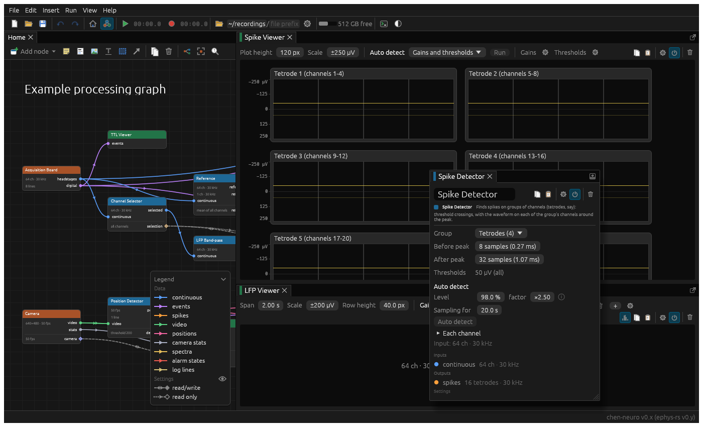
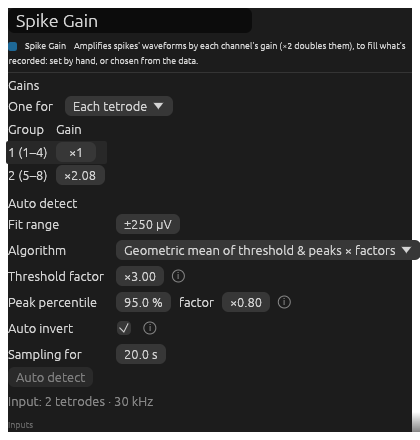
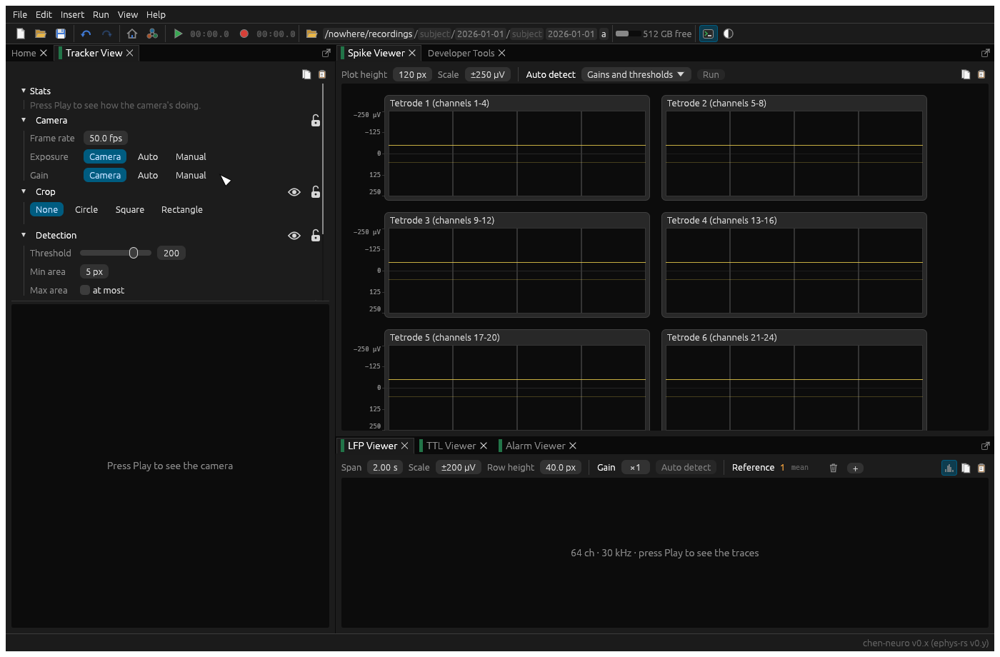

# Spikes

Spikes are detected in groups of channels (tetrodes, say) by a Spike Detector, scaled for recording by a Spike Gain,
and viewed, and tuned, in a Spike Viewer. A typical chain is: Acquisition Board → Reference → Band-pass Filter
(600–6000 Hz) → Spike Detector → Spike Gain → Write LTX, with a Spike Viewer after the gain.

Each component starts with what kind of node it is and its ports: data ports `like this`, settings ports marked ◇.

## Spike Detector

> **Processing.** In: `continuous` (filtered, µV). Out: `spikes`. ◇ `thresholds`.

Finds spikes: a crossing of a channel's threshold, either way (below its negative, or above it), on any channel of a
group, then the waveform on all the group's channels around the peak that follows (its furthest from zero). A group
can't spike again until its last spike's waveform has ended. Which way spikes go doesn't matter to it: a Spike
Gain's auto detect can turn channels whose spikes go up to go down, as most do.

**Settings**

- **Group**: single channels, stereotrodes (2), tetrodes (4) or octrodes (8).
- **Before peak**, **After peak**: how many samples of waveform to keep around the peak.
- **Thresholds**: each channel's, in µV past zero, either way. Most easily set from a Spike Viewer.
- **Auto detect**: chooses thresholds from the data. For each channel, it computes the **Level**'s percentile of its
  voltage over the sampling time (**for**), then sets its threshold to that percentile multiplied by the **factor**.
  Run it here, or from a Spike Viewer. **Each channel** shows what it chose for each.

## Spike Gain

> **Processing.** In: `spikes` (µV). Out: `spikes` (amplified µV). ◇ `gains`.

Amplifies each channel's spike waveforms by a gain, as an amplifier does: ×1 leaves them as they are, ×2 doubles
them. That's all a gain does: what's recorded of them is up to whatever records them (Write LTX's [scales](recording.md#write-ltx)
map ±250 µV to its −128 to 127, to begin with, clipping beyond). Gains go from ×¼ to ×4, and can be one for all
channels, one for each group (tetrode), or one each. A negative gain turns the spikes upside down as they're
recorded: stepping it keeps it negative.

Projects saved before gains amplified (when Write LTX's gains took µV to −128 to 127) are converted when they're
opened, to record just the same.

**Auto detect** samples each channel's spikes **for** a while, then sets each gain so that a value from them maps to
the upper limit of the **Fit range** (what's recorded: ±250 µV, Write LTX's spikes' scale, to begin with), as its
**Algorithm** says:

- **Threshold × factor**: the channel's threshold, times the **Threshold factor**.
- **Peak percentile × factor**: a percentile of its spikes' peaks (95 %, say, or 100 % for the biggest), times its
  **factor**.
- The **larger**, **mean** or **geometric mean** of the two, each times its factor. The geometric mean is the default.

With **Auto invert** (on, to begin with), it also turns each channel's spikes to go down, as most extracellular spikes
do (a Spike Viewer shows them pointing up): it adds up each channel's spikes' extrema (each spike's furthest point
from zero), and where the total's positive, it uses a negative gain. Channels sharing a gain go by all theirs together, and
a channel with no spikes stays as it was.

The range is never less than 1.5 × the threshold, so the threshold's always in view, and a channel with no spikes goes
by its threshold. If the thresholds change while it's sampling (moved by hand, say), it starts sampling again, so the
gains follow the new thresholds and the spikes they find.

Connect Write LTX's ◇ `gains` to it, and the gains are recorded in the `.set` file.

## Spike Viewer

> **Viewer.** In: `spikes`. ◇ `thresholds` (a Spike Detector's), ◇ `gains` (a Spike Gain's).

Each group's recent spikes, overlaid: a box per tetrode, with a plot per channel and its threshold. The spikes are
shown as they're recorded, amplified by their gain, so raising a gain makes them bigger. The plots show the **Scale**,
±250 µV to begin with: what Write LTX records, so a spike reaching the edge is clipped. Set it to see more, or
less. Each row of tetrodes has the scale on its y axis, at its left. Spikes are shown negative at the top, so the downward spikes most
channels record point up, as people expect. Each channel's threshold, amplified with the spikes, is the line above the middle, to drag, and fainter below
it, as spikes are found either way.

Connected to a detector's thresholds and a gain's gains, it sets them:

- Drag a threshold's line to move it.
- Over a channel, its **+** and **−** buttons raise and lower its gain, and the button beside **−** (a spike and its
  reflection), or pressing **I**, turns its spikes upside down, or back: a negative gain. It's highlighted while they are, and the plot
  shows them as they're recorded.
- Over a channel, press **T** to type its threshold (µV of what comes in), or **G** its gain (×). Up and down step it,
  Enter applies it, Esc cancels.
- **Auto detect** (gains, thresholds, or both) and **Run** triggers the detector's and gain's own auto detect. Both
  are done one after the other, the thresholds first, as the gains can go by them: it says which it's on, and what's
  next. The cogs beside **Gains** and **Thresholds** open their nodes' settings, which say how.

**Plot height** sets the size of each box, and **Scale** what they show.
