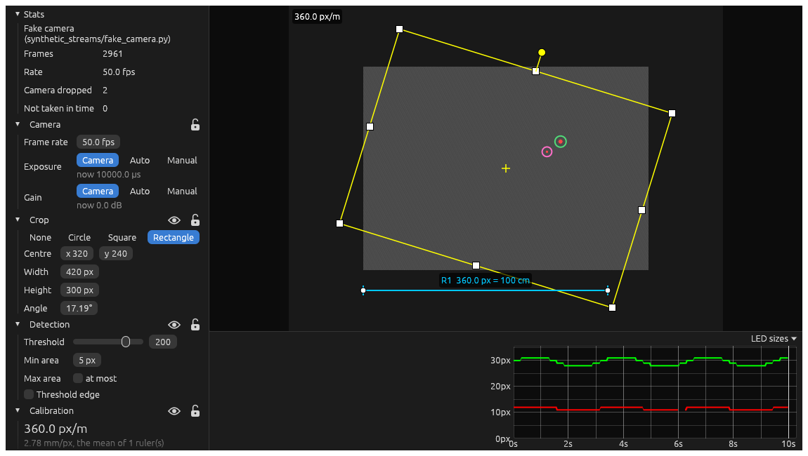
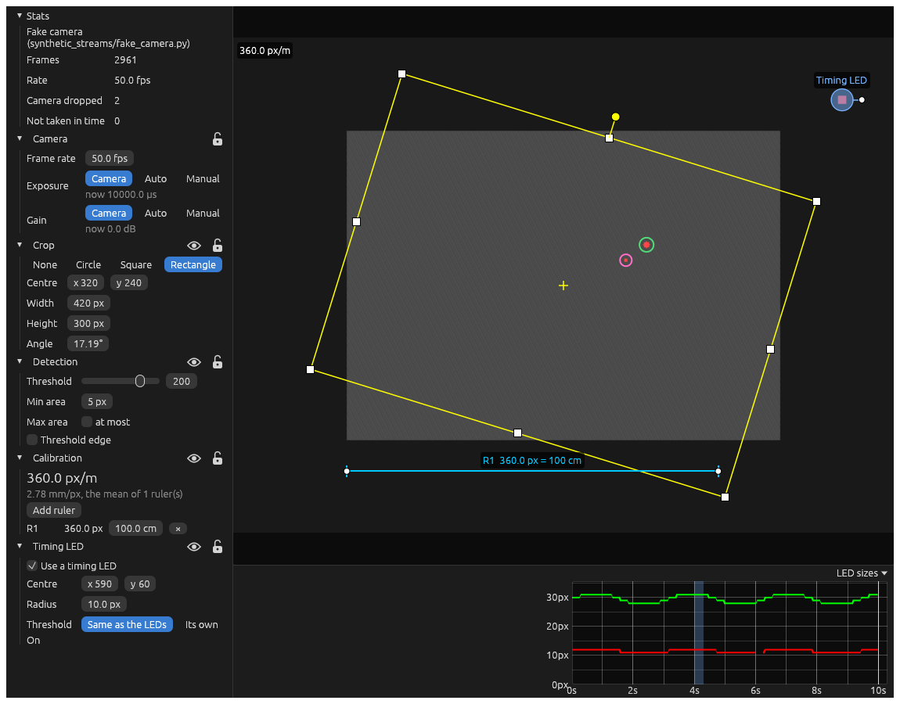
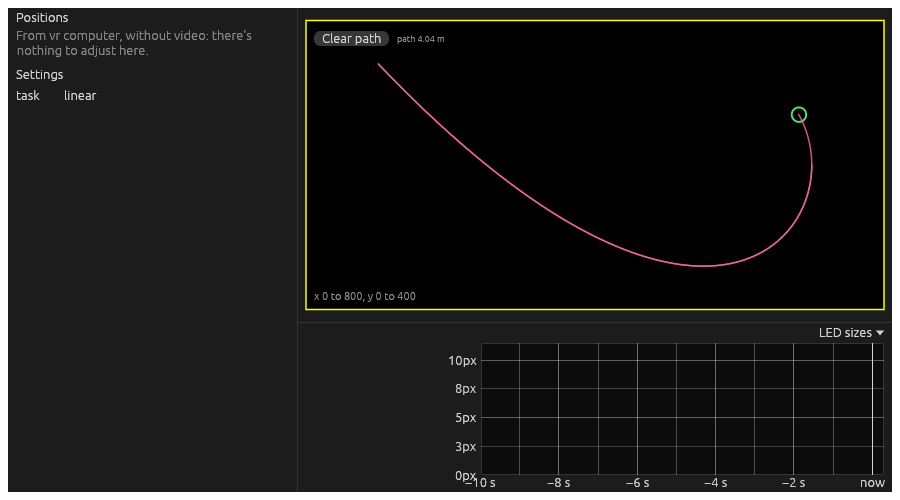

# Tracking

Tracking an animal by two LEDs on its head, in video from a camera, as the Open Ephys tracker plugin does. A typical
chain is: Camera → Position Detector → Write LTX, with a Tracker View connected to all three.

Each component starts with what kind of node it is and its ports: data ports `like this`, settings ports marked ◇.

> [!TIP]
> To synchronise video with electrophysiology, use a **timing LED**: a real LED in view of the camera, switched by the
> same TTL that the acquisition board records. See [timing LED](#timing-led) below, and
> [timing and synchronisation](../../README.md#timing-and-synchronisation).

## Camera

> **Source.** Out: `video` (8-bit grey frames), `stats` (how the camera's doing). ◇ `camera` (its exposure and gain).

Video from a camera:

- **Teledyne FLIR** cameras (Blackfly, Chameleon, Grasshopper...), through FLIR's Spinnaker SDK, which needs to be
  installed. Settings it doesn't change (trigger mode, region of interest...) are left as set in SpinView.
- The **fake camera** in `synthetic_streams/`, for trying things without hardware.

**Settings**: which camera (and its serial number), the **Frame size** and the **Frame rate**. Its exposure and gain
are set from a Tracker View.

## Position Detector

> **Processing.** In: `video`. Out: `positions`, `pos ttl` (the timing LED's ups and downs, as events). ◇ `detection`.

Finds the two biggest bright spots within the crop, in each frame: the LEDs. Its settings (the crop, the threshold,
the calibration, the timing LED) are best set from a Tracker View, over the video. Connect Write LTX's ◇ `detection`
to it to record them in the positions' header.

## Tracker View

> **Viewer.** In: `video`, `positions`, `stats`. ◇ `camera` (a Camera's), ◇ `detection` (a Position Detector's).

The camera's video with the LEDs found (the circles), and the crop and rulers over it to drag. On the left are the
camera's and the detector's settings, in sections. Each section's eye shows or hides it over the video, and its
padlock stops it being changed by accident. Below is a chart of the LEDs' sizes: steady lines mean steady tracking,
and gaps are frames where an LED wasn't found.

- **Stats**: frames, the rate, and how many the camera dropped or didn't arrive in time.
- **Camera**: frame rate, and exposure and gain: as the camera has them, automatic, or set by hand.
- **Crop**: none, a circle, a square or a rectangle. Drag it over the video: its sides and corners resize it, and the
  handle on top rotates it. LEDs are only looked for inside it, and positions are measured from its corner.
- **Detection**: the brightness **Threshold** a spot must pass, and its **Min area** and **Max area**.
- **Calibration**: pixels per metre, from rulers. Add a ruler, drag its ends across something of known length in the
  arena, and type the length.
- **Timing LED**: see below.

### Timing LED

Tick **Use a timing LED**, then drag its spot onto the LED in the video. Its coming on and going off are sent out of the
Position Detector's `pos ttl`, timed by the camera's clock, as the positions are. Write LTX records them in the
`.pos.ttl` file. Its threshold can be the same as the LEDs', or its own. The pale blue bars on the chart are when it
was on.

### Positions from elsewhere

Connected to positions without video (from another source, such as a VR computer), it shows the path in the area the
positions range over. **Clear path** starts it again. There's nothing to adjust here.

## Video Viewer

> **Viewer.** In: `video`.

Just the video, with nothing to adjust: for a second camera, say, or to watch without the tracking's overlays. It can
show a crosshair.
